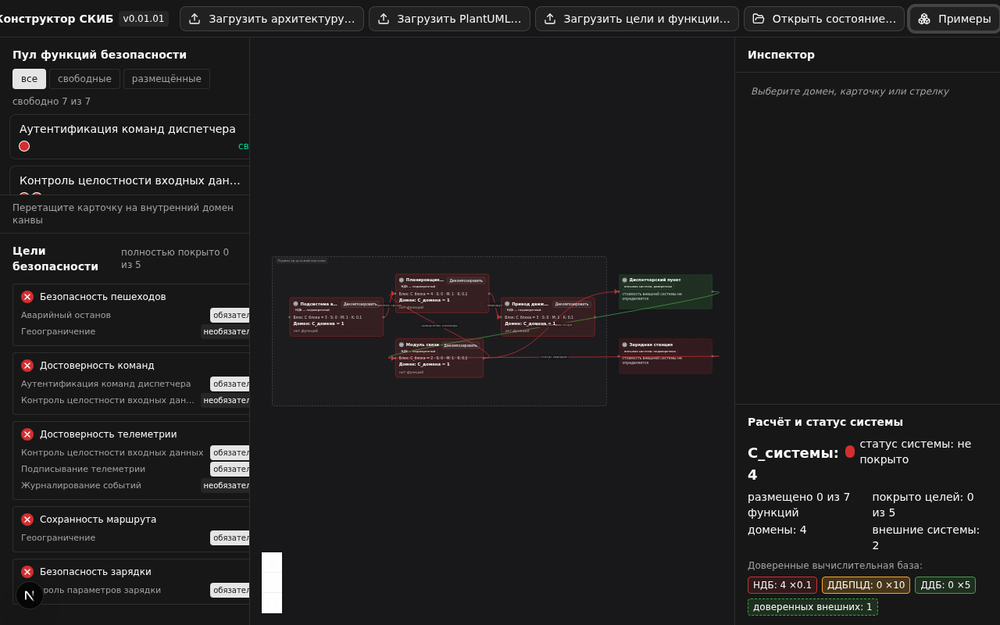

# Конструктор СКИБ (skib-lab)

Лабораторный веб-инструмент для практических занятий по курсу «Проектирование систем
с конструктивной информационной безопасностью» (контекст: ГОСТ Р 72118-2025,
ГОСТ ISO/IEC TS 19249-2021). Студент загружает функциональную архитектуру, размещает
функции безопасности (карточки) по доменам безопасности, наблюдает мгновенный пересчёт
стоимости по формуле ТЗ, автоматическую раскраску доверия доменов и потоков, светофор
покрытия целей, выполняет декомпозицию и сдаёт результат файлом `state.yaml`.

Серверной части нет: после загрузки страницы инструмент полностью автономен, данные
существуют только в браузере (localStorage) и в экспортированных файлах.



## Быстрый старт

```bash
make install     # установка зависимостей (npm ci)
make dev         # dev-сервер на http://localhost:3000
PORT=4000 npm run dev   # другой порт — переменная окружения PORT
```

Развёртывание в Docker (рекомендуется для учебного класса):

```bash
make docker-build
make docker-run   # порт 8080, проверка: curl http://localhost:8080/healthz → 200 ok
```

## Документация по ролям

| Роль | Документ | Содержание |
| --- | --- | --- |
| Студент (пользователь) | [docs/user-guide.md](docs/user-guide.md) | запуск, интерфейс, размещения, декомпозиция, сдача работы |
| Преподаватель | [docs/teacher-guide.md](docs/teacher-guide.md) | подготовка вариантов, сценарий занятия, проверка работ |
| Разработчик | [docs/developer-guide.md](docs/developer-guide.md) | архитектура слоёв, модель данных, релизы |
| Тестировщик | [docs/testing-guide.md](docs/testing-guide.md) | unit и E2E тесты, фикстуры, шаблон отчёта о дефекте |
| Администратор (развёртывание) | [docs/deployment-guide.md](docs/deployment-guide.md) | варианты В1–В4, Docker, Makefile, диагностика |

Спецификация модели и форматов данных — источник истины: ТЗ «Конструктор СКИБ»
v0.01.01 (разделы 3, 5–7). Краткая сводка: стоимость внутреннего домена
`C_домена = C_блока × S_eff × M × K`, где `S` — сумма стоимостей размещённых
функций (без функций — `C_блока × K`), `M = (E_вх + E_исх)/2` при
`E_вх + E_исх ≥ 2`, иначе `M = 1`, `K` — коэффициент доверия (НДБ 0.1, ДДБ 5,
ДДБПЦД 10); округление вверх один раз; `C_системы` — сумма по внутренним доменам,
внешние системы не тарифицируются; светофор целей по весам связей
mandatory/optional; классы доверия и цвета потоков пересчитываются автоматически (3.5 ТЗ).

## Демонстрационные примеры

Кнопка «Примеры» загружает один из двух контрольных комплектов ТЗ (14.4,
Приложения А–В): «Автономный коммунальный робот» (4 внутренних домена, 2 внешние
системы, 7 функций, 5 целей; контрольные числа C_системы 4 → 123 → 486) и
«Безэкипажное судно-доставщик» (4 внутренних домена, 2 внешние системы, 7 функций,
4 цели; C_системы 4 → 370). Файлы продублированы в `samples/robot/` и
`samples/vessel/` для подготовки собственных вариантов.

## Версия и статус

- Текущая версия: **0.01.04 (v0.01.04)** — всё объёма v0 (модель, стоимость,
  покрытие, пул и размещения, декомпозиция, undo/redo, автосохранение,
  импорт/экспорт architecture.yaml, security.yaml, state.yaml, PlantUML,
  Dockerfile, Makefile, unit- и E2E-тесты, документация по ролям), ревизия
  v0.01.01 (модель доверия НДБ/ДДБ/ДДБПЦД с автоматической раскраской (3.5),
  коэффициенты доверия в стоимости (3.3, 7.1), внешние (смежные) системы и
  рамка периметра, перестановка панелей и тема интерфейса, два демонстрационных
  примера), читаемость канвы v0.01.02 (кнопки «Стрелки» и «Периметр», диалог
  «Справка», укрупнённые метрики), работа с раскладкой и стрелками
  v0.01.03 (автоматическая раскладка доменов по слоям связей, как во
  Flying Logic, свёртка стрелок портов кнопками «+/−», мини-навигатор
  как в Archi, кнопки масштаба с «вместить диаграмму», запоминание ручной
  конфигурации и вида канвы, статус системы полным предложением, панель
  «Расширенный анализ ДВБ», терминология ДВБ вместо ТКБ) и трассировка
  v0.01.04: стрелки обходят домены по свободным сторонам (решётка A*,
  src/engine/edgeRouting.ts), наведение на строку в таблице ДВБ подсвечивает
  домен на диаграмме и в мини-навигаторе, клик по строке — фокус на домене
  (в центр, с укрупнением) и выбор, версия в заголовке страницы — из единого
  источника APP_VERSION (196 unit + 22 E2E).
- История изменений: [CHANGELOG.md](CHANGELOG.md).
- Среда разработки: Node.js 22.12+ (или Bun 1.3+), npm. Сборка — Next.js 16 со
  статическим экспортом (адаптация стека ТЗ, см. developer-guide). Базовый образ
  сборки — node:22-alpine (vitest 5 требует Node ≥ 22).
