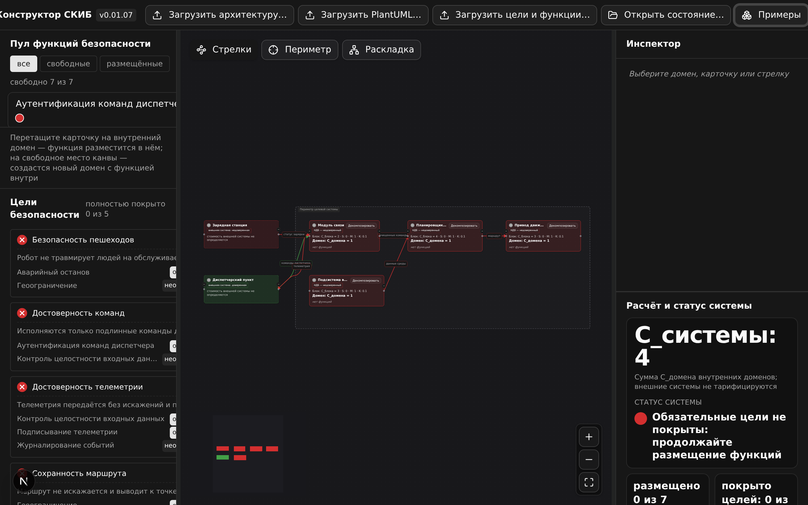
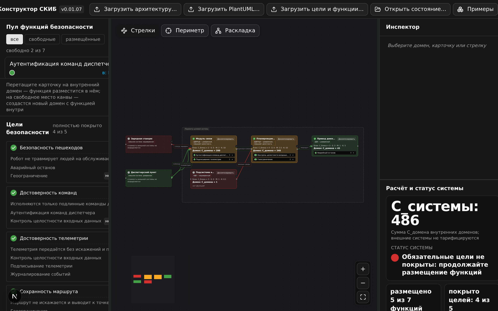

# Руководство преподавателя

Версия соответствует 0.01.07. Спецификация форматов — раздел 6 ТЗ (источник истины);
модель доверия — раздел 3.5 ТЗ.

## 1. Методика составления security.yaml

Файл задаёт цели и функции безопасности со связями «функция — цель» и весами
(раздел 6.2, решение D4):

- **mandatory** — функция необходима для признания цели покрытой; цель зелёная,
  только когда размещены все её обязательные функции.
- **optional** — вспомогательная функция; влияет только на жёлтый статус
  («частично») и на состав домена.

Практика весов: 1–2 обязательные функции на цель; optional — для сопоставления
вариантов («студент закрыл цель сверх минимума»). Цель без функций всегда красная
(W-003), функция без целей — предупреждение W-004. Функция хотя бы с одной связью
считается критичной и вводит домен в ДВБ — доверенную вычислительную базу
(3.5 ТЗ) — учитывайте это при проектировании варианта: в примере 1 семь карточек,
каждая связана минимум с одной целью. С v0.01.06 домен можно ввести в ДВБ и
принудительно, без критичной функции (переключатель «Ввод в ДВБ» в инспекторе) —
удобно для сценариев вида «в системе есть доверенные датчики»; признак
`forceTrusted` сохраняется в `state.yaml` студента и виден в «Расширенном анализе
ДВБ» со звёздочкой. С v0.01.06 на карточке цели под кратким названием выводится
полная формулировка инварианта — требуйте полные тексты и в студенческих
`security.yaml` (поле `description` цели).

## 2. Методика составления architecture.yaml

Файл описывает блоки (стоимость реализации `C_блока`), координаты для канвы,
внешние системы (`external: true`, доверенность — `trusted: true/false`) и
стрелки (раздел 6.1). Множитель связности `M = (E_вх + E_исх)/2` при сумме ≥ 2
заметно влияет на стоимость: домен с 3+ связями дорожает — полезно для обсуждения
изоляции доменов. Коэффициент доверия K (НДБ 0.1, ДДБ 5, ДДБПЦД 10) делает
доверенные домены дороже — стройте варианты так, чтобы студент сопоставлял
цену гарантий и цену потока от недоверенной смежной системы. Заготовки — в
`samples/robot/` (Приложения А–В ТЗ) и `samples/vessel/`.

## 3. Сценарий занятия (90 минут)

| Этап | Время | Действия |
| --- | --- | --- |
| Выдача варианта | 10 мин | преподаватель раздаёт `architecture.yaml` и `security.yaml` варианта |
| Проектирование | 45 мин | студенты размещают карточки, добиваясь покрытия; `state.yaml` сохраняется автоматически |
| Декомпозиция | 20 мин | выделить домен, обосновать декомпозицию и «цену изоляции» |
| Защита решения | 15 мин | студент сдаёт `state.yaml`, объясняет статусы и стоимость |

## 4. Готовые варианты заданий

1. **«Минимальная стоимость при полном покрытии»** — всем целям нужен зелёный
   статус; победитель — наименьшая `C_системы`. Проверяется панелью расчёта системы.
2. **«Два варианта декомпозиции»** — сравнить `C_системы` до и после декомпозиции
   домена с 3+ связями при разных назначениях стрелок потомкам.
3. **«Найти и закрыть непокрытую цель»** — в security.yaml одна цель намеренно
   обеспечена только optional-функциями; студент должен объяснить, почему цель
   не станет зелёной, и предложить вариант модели (пополнить mandatory).
4. **«Граница доверия»** (специфично для v0.01.01) — в архитектуре есть смежная
   система; студент должен объяснить картину доверия (НДБ/ДДБ/ДДБПЦД), показать,
   какой поток остаётся низкоцелостным, и оценить, во сколько обойдётся
   доверенность приёмника (сравнить K = 10 и K = 5).
5. **«Доверенные датчики»** (v0.01.06) — в варианте есть домен с датчиками,
   который обязан быть доверенным без функции безопасности; студент вводит его
   в ДВБ принудительно («Ввод в ДВБ» в инспекторе), объясняет рост стоимости
   (K = 0.1 → 5, при красных входах 10) и изменение целостности исходящих
   потоков; зачёт — по признаку `forceTrusted` в `state.yaml`.

## 5. Проверка работ

Импортируйте `state.yaml` студента через «Открыть состояние…» — проект заменяется
целиком после подтверждения (Ф-4). Контрольные точки оценивания:

- **полнота покрытия** — «покрыто целей Z из N» в панели расчёта системы и статусы
  в панели целей;
- **стоимость** — `C_системы` относительно бюджета, заданного в варианте;
- **обоснованность декомпозиции** — по диалогу и составу потомков (в `state.yaml`
  сохраняются имена и стоимости).

Контрольные примеры с эталонными числами — раздел 14.4 ТЗ v0.01.01 и доработка
v0.01.05: пример 1 «Автономный коммунальный робот» — после загрузки `C_системы = 4`,
шаг 1 — `486` (link 200 ДДБПЦД + plan 240 ДДБПЦД + drive 45 ДДБ + perc 1 НДБ);
пример 2 «Безэкипажное судно-доставщик» — после загрузки `10` (10 внутренних
доменов), шаг 1 — `943` (radio 250, nav 480, avoid 120 — ДДБПЦД; ota 68,
cargo 20 — ДДБ; остальные НДБ). Числа удобно использовать как задание-разминку
на проверке.

## 6. Приложения-шаблоны

`samples/robot/architecture.yaml`, `samples/robot/security.yaml`,
`samples/robot/architecture.puml`, `samples/robot/state.yaml` (и аналогичный
комплект `samples/vessel/`) — готовые заготовки для новых вариантов; копируйте
и меняйте цели, функции, стоимости и внешние системы.

## 7. Частые вопросы студентов

- **«Почему домен без функций всё равно стоит денег?»** — домен без функций стоит
  `C_блока × K`; для НДБ это 10 % от C_блока, для доверенного — в 5–10 раз дороже
  (раздел 3.3, правило 2; 3.5 ТЗ).
- **«Почему домен стал жёлтым?»** — домен введён в ДВБ (в нём есть критичная
  функция или он введён принудительно), но в него входит хотя бы одна красная
  стрелка — низкоцелостный поток: это ДДБПЦД, коэффициент 10 (3.5 ТЗ).
  Сделайте источник доверенным или переподключите поток — домен станет
  зелёным (ДДБ, K = 5).
- **«Почему после декомпозиции сумма изменилась?»** — каждый потомок заново
  применяет формулу со своей базовой стоимостью; компенсации нет (правило 4).
- **«Карточка перемещается, а не копируется»** — правило единственного размещения
  (раздел 3.2): функция ровно в одном домене либо в пуле.
- **«Почему во внешнюю систему не положить карточку?»** — внешние системы не
  получают функций, не декомпозируются и не входят в C_системы (3.5 ТЗ);
  сброс карточки на свободное место канвы (v0.01.06) создаёт новый внутренний
  домен с функцией внутри.
- **«Почему домен зелёный, хотя в нём нет функций?»** — домен введён в ДВБ
  принудительно: проверьте «Ввод в ДВБ» в инспекторе и звёздочку у типа
  в «Расширенном анализе ДВБ» (v0.01.06).
- **«Панель ошибок не даёт загрузить файл»** — ошибки блокируют применение файла
  целиком (Ф-6): исправьте указанные коды и загрузите снова.
