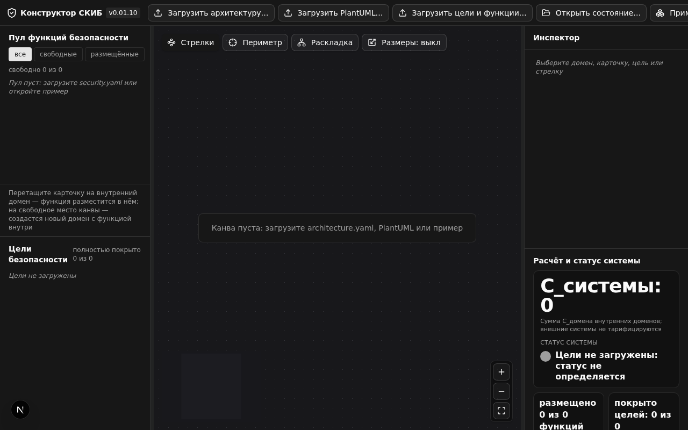
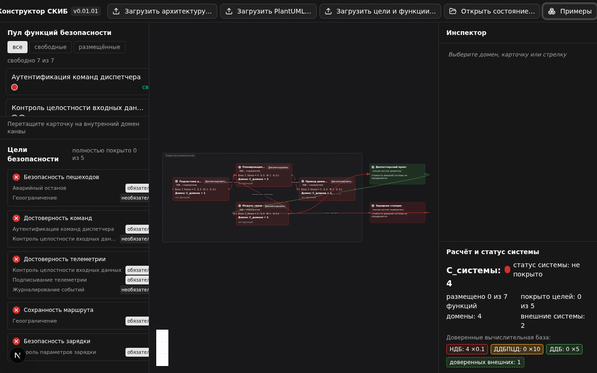
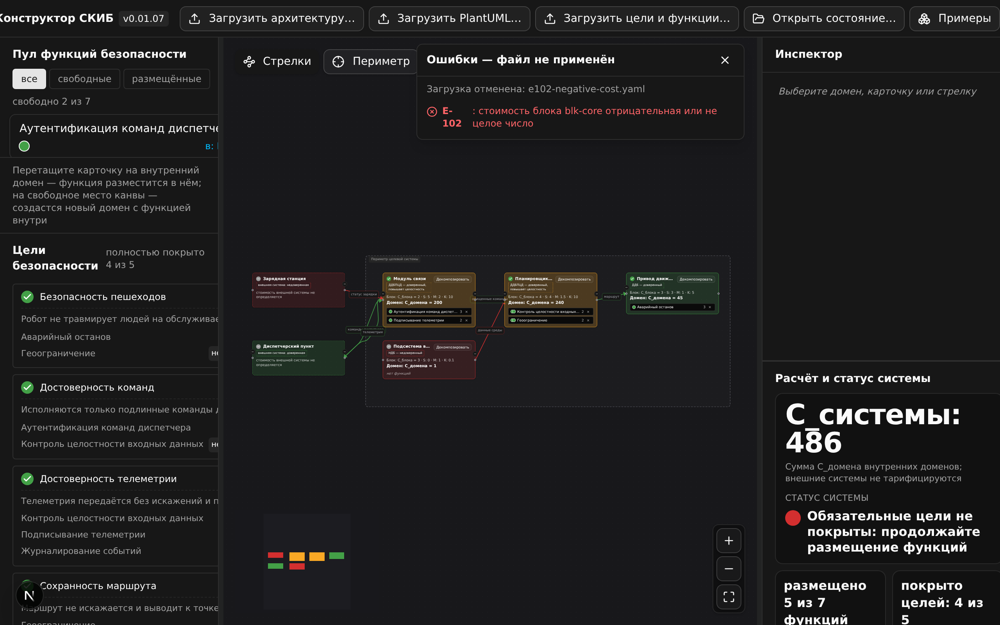
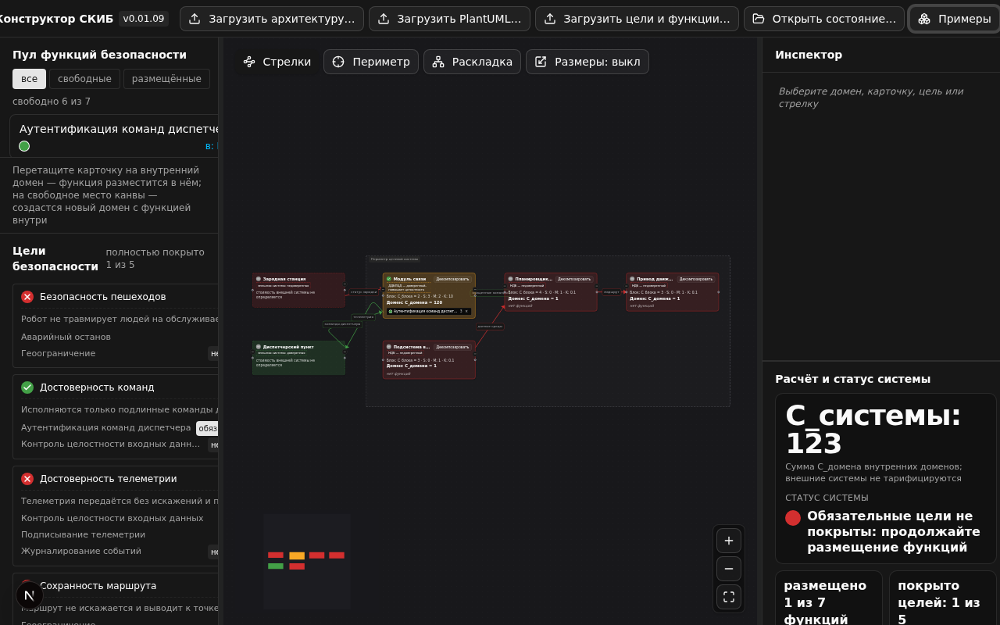
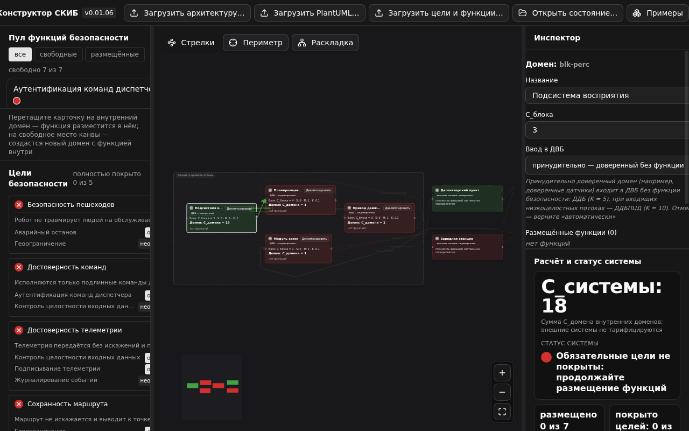
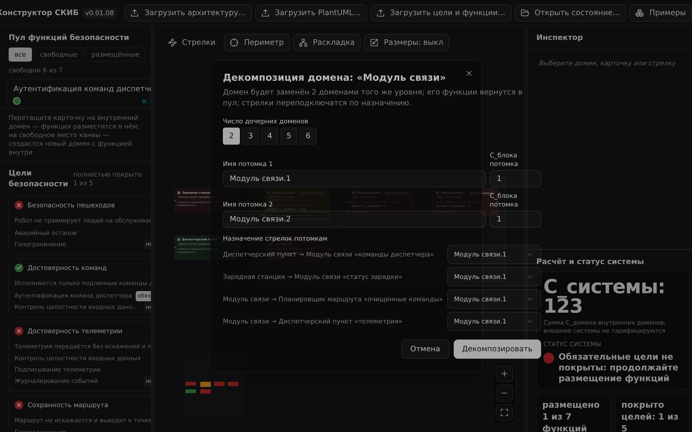
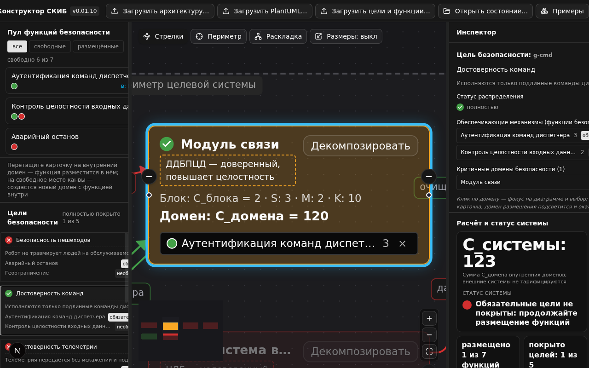
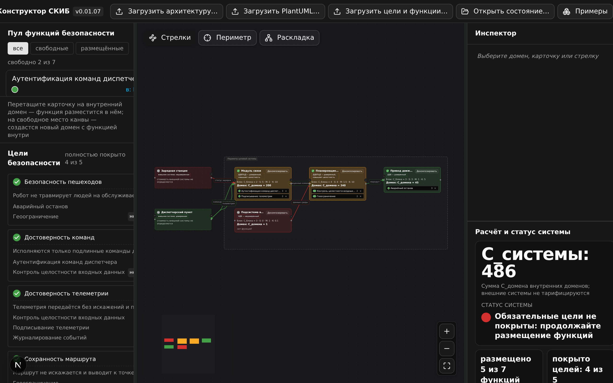
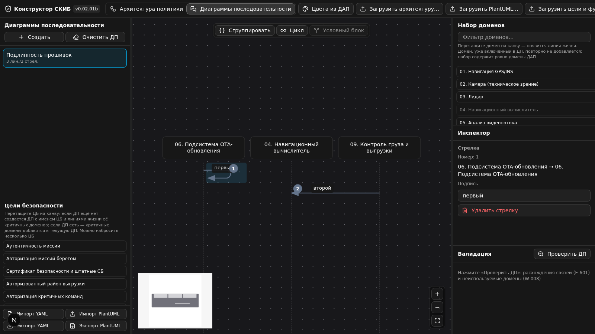

# Руководство пользователя (студент)

Версия соответствует 0.02.01b. Термины — по разделу 2 ТЗ; формулы — по разделам 3.3
и 3.5; модель доверия — по разделу 3.5 ТЗ; режим ДП — частное ТЗ v0.02.01.

## 1. Запуск и восстановление сеанса

Откройте адрес, выданный преподавателем (например, `http://<сервер>:8080`).
Инструмент загружается целиком в браузер и не требует сети. Если вы уже работали
раньше с этого же адреса, проект восстановится автоматически — автосохранение
выполняется после каждой операции (Ф-22). Кнопка «Сбросить проект» очищает
локальное сохранение и возвращает инструмент к пустому состоянию (Ф-23).
Интерфейс по умолчанию открывается в тёмной теме; переключатель светлой/тёмной
темы — в правой части верхней панели, выбор запоминается (5.1 ТЗ).

## 2. Зоны интерфейса

- **Верхняя панель** — загрузка файлов, «Примеры» (демонстрационные комплекты),
  «+ Домен», «+ Внешняя система», «Проверить» (v0.01.08), «Экспорт»,
  «Сбросить проект», «Отменить»/«Вернуть»,
  переключатель темы, индикатор валидации (чисто / предупреждения / ошибки)
  и кнопка «Справка» с кратким путеводителем по интерфейсу (v0.01.02).
- **Пул карточек (слева сверху)** — функции безопасности со стоимостью (у.е.),
  точками статусов целей и отметкой «свободна / в: <домен>»; фильтры
  «все / свободные / размещённые».
- **Цели безопасности (слева снизу)** — светофор каждой цели и её состав:
  обязательные и необязательные функции с отметками размещения (Ф-19); цели ПЛО
  «при любых обстоятельствах» (v0.01.05) отличены подсказкой строки — значок «(*)»
  из коротких формулировок убран (v0.01.08), над списком целей
  выведены формулировки предположений безопасности. Под кратким названием цели
  видна её полная формулировка — инвариант безопасности системы (v0.01.06).
  Панель раздвижная: потяните вертикальный разделитель между панелью и канвой,
  чтобы текст помещался целиком. Высота области целей изменяема и по вертикали
  (v0.01.10): потяните горизонтальный разделитель между пулом и целями —
  пропорции запоминаются между сеансами.
- **Канва (центр)** — внутренние домены внутри штриховой рамки периметра целевой
  системы и внешние (смежные) системы за рамкой (3.5 ТЗ). Узел показывает имя,
  класс доверия (НДБ / ДДБ / ДДБПЦД), `C_блока`, `S`, `M`, `K`, `C_домена`
  полужирным, статус, карточки размещённых функций и кнопку «Декомпозировать».
  Над канвой — кнопки вида «Стрелки» и «Периметр» (см. 5.2).
- **Инспектор (справа сверху)** — свойства выбранного домена, карточки, стрелки
  или внешней системы; у внешней системы — переключатель доверенности;
  у внутреннего домена — переключатель «Ввод в ДВБ» (v0.01.06, см. раздел 4).
- **Расчёт и статус системы (справа снизу)** — `C_системы` самым крупным шрифтом
  панели, статус системы с цветовым индикатором, число доменов и внешних систем,
  «размещено X из Y», «покрыто целей Z из N» — плитками с полужирными значениями
  (v0.01.02), разбивка доменов по классам доверия с коэффициентами (Ф-20).
  Высота области изменяема по вертикали (v0.01.06): потяните горизонтальный
  разделитель между инспектором и областью расчёта вверх — метрикам достанется
  больше места для больших примеров; положение запоминается между сеансами.
  Ниже — «Расширенный анализ ДВБ»; обе области прокручиваются вместе.

Цвета светофора и доверия продублированы значками и подписями: крест — «не
покрыта», половина круга — «частично», галочка — «полностью», серый — «нет
функций»; заливка домена подписана НДБ / ДДБ / ДДБПЦД, внешняя система —
«доверенная» / «недоверенная» (раздел 5.3).

## 3. Загрузка файлов и демонстрационные примеры

- «Загрузить архитектуру…» — файл `architecture.yaml` (Ф-1); «Загрузить PlantUML…» —
  то же в формате PlantUML (Ф-3). Загрузка заменяет архитектуру, размещения сбрасываются
  в пул; при наличии правок инструмент запросит подтверждение.
- «Загрузить цели и функции…» — `security.yaml` (Ф-2); размещения сохранившихся функций
  сохраняются.
- «Открыть состояние…» — `state.yaml`: полный снимок сеанса (Ф-4).
- «Примеры» — два демонстрационных комплекта одной командой (Ф-5):
  «Автономный коммунальный робот» (14.4.1 ТЗ) и «Безэкипажное судно-доставщик»
  (доработка v0.01.05: навигация GPS/INS, камера с анализом видеопотока, лидар,
  бортовой ИИ и подсистема OTA-обновления; 9 целей ПЛО, 2 предположения,
  10 механизмов безопасности).
- Любой файл проверяется перед применением; при ошибках файл не применяется, а панель
  справа показывает коды и номера строк (Ф-6, Ф-26).

## 4. Работа с пулом: размещение, перемещение, возврат

1. Перетащите карточку из пула на узел внутреннего домена — появится размещение
   (Ф-8). Перетащите карточку на свободное место канвы — сразу создастся новый
   домен безопасности с этой функцией внутри (v0.01.06): домен выделяется,
   переименовать его можно в инспекторе; Ctrl+Z убирает и домен, и размещение.
   Разместить карточку во внешнюю систему нельзя (3.5 ТЗ) — сброс на неё
   отклоняется с подсказкой.
2. Перемещение между доменами в v0.01.01 — через инспектор: выберите карточку и
   используйте список «Переместить в…» (Ф-9). Повторное размещение — всегда
   перемещение, а не копирование (правило 3.2).
3. Кнопка «×» у карточки внутри узла возвращает функцию в пул (Ф-10).

Размещение функции, критичной хотя бы для одной цели (есть связь с целью безопасности),
вводит домен в доверенную вычислительную базу (ДВБ): домен перекрашивается — зелёный
(ДДБ), если входящие стрелки зелёные, жёлтый (ДДБПЦД), если в домен входит хотя бы одна
красная стрелка. Все исходящие стрелки доверенного домена становятся зелёными. Стоимость
домена умножается на коэффициент доверия K: НДБ — 0.1, ДДБ — 5, ДДБПЦД — 10 (3.3, 3.5 ТЗ).

### 4.1. Принудительный ввод домена в ДВБ (v0.01.06)

Иногда доверенный домен нужен в системе без функции безопасности — например,
доверенные датчики в составе целевой системы. Выберите внутренний домен и в
инспекторе переключите «Ввод в ДВБ» с «автоматически — по критичной функции»
на «принудительно — доверенный без функции»: домен станет ДДБ (K = 5), а при
входящих красных стрелках — ДДБПЦД (K = 10); его исходящие потоки будут
высокоцелостными. Такой домен появляется в «Расширенном анализе ДВБ» со
звёздочкой у типа. Признак сохраняется в `architecture.yaml` и `state.yaml`
(поле `forceTrusted`); внешним системам он не применяется — их доверенность
задаётся переключателем «Доверенность внешней системы». Чтобы вернуться
к автоматическому классу, выберите «автоматически».

## 5. Декомпозиция домена

Кнопка «Декомпозировать» на узле внутреннего домена открывает диалог (Ф-16): число
потомков 2–6, имена и `C_блока` потомков (по умолчанию 1), назначение каждой стрелки
исходного домена одному из потомков. После применения исходный домен удаляется, потомки
добавляются на тот же уровень, функции возвращаются в пул, стоимости и раскраска
пересчитываются. Декомпозиция не компенсируется: сумма стоимостей потомков обычно
отличается от стоимости исходного домена — это «цена изоляции» (раздел 3.3, правило 4).
Внешние системы не декомпозируются.

### 5.1. Соединение доменов и чтение стрелок

Соединение доменов — перетаскиванием (Ф-14): потяните от точки любого домена
к другому — направление стрелки задаёт жест (v0.01.08): откуда началось
перетаскивание, тот домен и источник; прилепиться можно к любой точке домена,
а не только к точке. Точки соединения без семантики «вход/выход»: стрелка
выходит и входит с той стороны, которая обращена к собеседнику, а точка по
высоте тянется к нему (скользящие якоря v0.01.08). Форма стрелки строится
по трём приоритетам (v0.01.09): максимум длины прямых отрезков, минимум
углов, углы скругляются дугами без острых изломов. С v0.01.10 у портов
стоит ещё одно жёсткое правило: вход в блок и выход из него — строго
по горизонтали, перпендикулярно границе домена. У каждого порта стрелка
имеет короткий горизонтальный «усик»-якорь: вход под острым углом и
вертикальный «крючок» у порта исключены, а крутые прямые стрелки
(наклон круче 45°) «сплющиваются» — горизонтальный подход, наклонный
участок и горизонтальный вход. Стрелка не может нырнуть внутрь своего
домена и вынырнуть к порту: соединяемые домены — препятствия трассировки.
Прямая стрелка строится
всегда, когда ей ничего не мешает; обход промежуточных доменов — сначала
чистыми ортогональными ходами через свободные зазоры между доменами
(с двумя поворотами или одним — Г-образно), затем решёткой со штрафом
за поворот: путь получается с длинными прямыми участками и без «ступенек».
Линии с общими доменами расходятся параллельными дорожками, а незнакомые
стрелки не отклоняются от чужих коридоров — «необъяснимых изломов» нет.
Подпись стрелки правится в инспекторе.

Чтобы разобрать запутанную диаграмму, наведите курсор на стрелку или домен: связанные
стрелки подсветятся и будут выведены поверх узлов, остальные погаснут. Тот же эффект
даёт выделение стрелки или домена щелчком. Подписи стрелок лежат на непрозрачной плашке
с контуром цвета стрелки; длинные подписи сокращены — полный текст появляется на
подсвеченной стрелке. Параллельные стрелки одной пары доменов разведены по дугам.

Кнопка **«Раскладка»** над канвой выстраивает домены по слоям связей, как это делает
Graphviz (v0.01.07): порядок в колонках подбирается под минимум пересечений стрелок,
домены выравниваются по своим связям (цепочки стрелок ложатся в прямую линию), внешние
системы-источники (командные центры) встают слева от периметра, приёмники — справа;
циклы разрываются «обратной дугой» и больше не уводят цепочку доменов в последний слой.
Стрелки, которым тесно в общем коридоре, расходятся параллельными дорожками; встречные
стрелки (приёмник левее источника) выходят из левого порта источника и входят в правый
порт приёмника. Повторное применение после перемещения доменов — просто нажмите кнопку
ещё раз; отмена — Ctrl+Z.

### 5.2. Управление видом канвы (v0.01.02)

Над канвой кнопки вида:

- **«Стрелки»** — скрывает и показывает стрелки-связи. Если стрелки мешают
  работать с диаграммой, скройте их, переместите домены и верните обратно.
  Скрытие касается только вида: стоимости, статусы и состав ДВБ пересчитываются
  по-прежнему полностью.
- **«Периметр»** — фокус на внутреннем периметре системы: все внешние системы
  и связи с ними скрываются, остаётся внутренняя архитектура с рамкой периметра.
  Повторное нажатие возвращает внешний контур. Расчёты не меняются: внешние
  потоки по-прежнему учитываются в множителе связности M.
- **«Размеры»** (v0.01.08) — автоматические размеры доменов по циклу
  «выкл → стоимость → C_блока»: площадь узла пропорциональна значению
  (квадратный корень нормированной стоимости, рост до 1.8 раза). В режиме
  «стоимость» вес ДВБ виден сразу — коэффициент K раздувает доверенные домены;
  в режиме «C_блока» сравниваются базовые стоимости без коэффициентов.
  Внешние системы остаются базового размера, расчёты и модель не меняются;
  трассировка и «Раскладка» учитывают новые габариты автоматически.

Настройки вида действуют до перезагрузки страницы: диаграмма всегда открывается
в полном виде, скрыть связи и забыть об этом невозможно.

Кнопка **«Справка»** в верхней панели открывает краткий путеводитель: порядок
работы, обозначения блока (C_блока, S, M, K), цвета доменов и стрелок, приёмы
самопроверки.

## 6. Панель целей, проверка и советы

Над списком целей выводятся предположения безопасности (v0.01.05) — свойства среды,
принимаемые как данность при формулировании целей (например, благонадёжность
аутентичной береговой системы). Цели ПЛО («при любых обстоятельствах») безусловны
и не опираются на предположения; значок «(*)» из коротких формулировок убран
(v0.01.08) — признак хранится в файлах (unconditional) и показан в подсказке
строки цели. На карточке
цели, ниже краткого названия, видна полная формулировка инварианта (v0.01.06):
например, «Аутентичность миссии — При любых обстоятельствах выполняются только
аутентичные миссии».

Состав каждой цели: обязательные (mandatory) и необязательные (optional) функции
с отметками размещения (Ф-19). Необязательные функции не делают цель зелёной, пока
не размещены все обязательные.

Карточка ЦБ (v0.01.09): клик по цели открывает её карточку в инспекторе —
сводку «что обеспечивает цель и где»: обеспечивающие механизмы (функции
безопасности) с весом связи (обязательная/необязательная), стоимостью и
доменом размещения, статус
распределения — светофор покрытия цели («полностью / частично / не покрыто»)
— и критичные домены: домены, где размещены обязательные механизмы цели,
с их типами доверия (ДДБ, ДДБПЦД, НДБ). Клик по домену в карточке центрирует
диаграмму на нём и выбирает домен; наведение подсвечивает домен, как строка
таблицы ДВБ. Кликом по цели все её критичные домены кратко подсвечиваются
на канве голубым кольцом, остальные домены приглушаются (примерно как при
подсветке стрелок); подсветка гаснет сама через пару секунд — повторный клик
перезапускает её, выбор домена в карточке гасит сразу. Если у цели нет
размещённых обязательных функций, критичных доменов нет и приглушения
не возникает. Мини-навигатор подсвечивает те же домены.

Вмещение и фокус (v0.01.10): тот же клик по цели подгоняет масштаб диаграммы
так, чтобы домены всех её обеспечивающих механизмов помещались в видимую
область целиком — не нужно искать разбросанные по диаграмме домены вручную.
Клик по функции —
в карточке ЦБ или в пуле карточек — подсвечивает домен её размещения
(голубое кольцо) и помещает его в центр экрана с укрупнением; у функции
в пуле домена нет — карточка просто открывается.

Кнопка **«Проверить»** в верхней панели (v0.01.08) сверяет трассировку
«цель → функция → домен» по текущему состоянию диаграммы: цели с неразмещёнными
обязательными функциями (E-501; для безусловных целей ПЛО — E-502) и функции,
связанные с целями, но не размещённые ни в одном домене (W-006). Если пробелов
нет — тост «ошибок и предупреждений нет»; иначе открывается панель валидации
с заголовком «Проверка диаграммы».

Панель **«Советы по архитектуре»** справа (v0.01.08, под таблицей ДВБ) предлагает
улучшения модели с точной оценкой экономии C_системы: каждый кандидат
«что-если» пересчитывается по формуле стоимости. Декомпозиция ДДБПЦД с
несколькими функциями (приёмник низкоцелостного потока остаётся, остальные
функции возвращаются в ДДБ — K: 10 → 5), вынос некритичных функций из
доверенного домена (K: 5 → 0.1), дешёвый посредник для низкоцелостных входов,
пустые и изолированные домены, функции без связей с целями, непокрытые цели.
Наведение подсвечивает домен-адресат, клик — фокус и выбор в инспекторе.
Советы никогда не применяются автоматически: инструмент показывает экономию,
а перестраивает модель студент — вручную.

## 7. Сохранение, экспорт и сдача работы

Состояние сохраняется автоматически. Экспорт (Ф-24): `state.yaml` — полный снимок
для сдачи; `architecture.yaml` — блоки и стрелки с координатами (включая внешние
системы); `architecture.puml` — диаграмма в PlantUML. Сдайте `state.yaml`
преподавателю.

## 8. Горячие клавиши

- `Ctrl+Z` — отменить, `Ctrl+Y` — вернуть (Ф-21);
- `Delete` — удалить выбранную стрелку (НФ-10);
- масштаб канвы — колесо мыши или кнопки управления.

## 9. Типовые учебные сценарии

- «Достичь полного покрытия при минимальной `C_системы`» — размещайте карточки и
  сравнивайте варианты по панели расчёта системы; помните, что доверенный домен
  дороже (K = 5 или 10), а недоверенный — дешевле (K = 0.1), но не даёт гарантий.
- «Сравнить два варианта декомпозиции» — выполните декомпозицию дважды с разными
  назначениями стрелок и сравните суммы.
- «Найти и закрыть непокрытую цель» — красная цель в панели целей подсказывает,
  каких функций не хватает.
- «Оценить границу доверия» — переключите доверенность внешней системы в инспекторе
  и проследите, как перекрашиваются потоки и пересчитывается стоимость доменов-приёмников.

## 10. Частые вопросы и сообщения об ошибках

| Сообщение | Что делать |
| --- | --- |
| `E-001: файл не является корректным YAML (строка N)` | проверьте синтаксис файла в указанной строке |
| `E-102/E-207: стоимость отрицательная или не целое число` | стоимости — целые числа ≥ 0 |
| `E-208: дубликат id предположения` | идентификаторы предположений должны быть уникальными |
| `E-103/E-205: ссылка на несуществующий объект` | исправьте идентификаторы в файле |
| `E-401: неподдерживаемая версия state.yaml` | файл сохранён другой версией схемы |
| «Файл больше 5 МБ» | уменьшите файл (НФ-7) |
| Проект «пропал» после смены адреса | автосохранение привязано к адресу сайта — откройте `state.yaml` через «Открыть состояние…» |
| «Домен не принимает карточки» | это внешняя система: функции размещаются только во внутренних доменах (3.5 ТЗ) |

## 11. Режим «Диаграммы последовательности» (v0.02.01, v0.02.01b)

Переключатель «Архитектура политики / Диаграммы последовательности» — в верхней
панели (Ф-37). В режиме ДП левая панель — список ДП, правая — «Набор доменов»,
«Инспектор» и «Валидация»; канва рисует диаграмму: заголовки линий жизни сверху
и пунктирные линии жизни до нижней границы экрана (как на UML-диаграммах —
v0.02.01b), стрелки с автонумерацией 1..N, рамки блоков.

- **Создание ДП** — кнопка «Создать» (имя уникализируется: «Новая ДП», «Новая ДП 2», …);
  «Очистить ДП» удаляет содержимое текущей ДП (линии жизни, стрелки, блоки)
  после подтверждения — одна операция истории (v0.02.01b); «Удалить» — удаляет
  ДП целиком (с подтверждением). Лимиты: 20 ДП, 24 линии жизни, 100 стрелок,
  10 блоков (Ф-58).
- **Линии жизни** — перетащите домен из «Набора доменов» на канву; набор содержит
  ровно домены ДАП (П-12), в блоке есть фильтр по подстроке (v0.02.01b). Порядок
  линий жизни меняется перетаскиванием заголовка по горизонтали. Стрелку создаёт
  перетаскивание от одной линии жизни к другой (на себя — self-стрелка) в любой
  точке линии. Домены, не вошедшие ни в одну ДП, перечисляются в валидации (W-008).
- **Стрелки и блоки** — подпись стрелки редактируется в инспекторе: поле обновляется
  при смене выбранной стрелки и применяется по Enter или потере фокуса
  (v0.02.01b). Выделите стрелки кликом с Shift/Ctrl и примените «Сгруппировать»,
  «Цикл» или «Условный блок»: группа и цикл — цветная рамка (палитра 8 цветов),
  условный блок — рамка с разделителем веток «то/иначе» (диалог: условие, подписи
  веток, граница else). Перенос стрелки по вертикали меняет нумерацию сразу.
- **Цели безопасности** — в левой панели список ЦБ (v0.02.01b): набросьте ЦБ на
  канву — если ДП ещё нет, создастся ДП с именем ЦБ и линиями жизни её критичных
  доменов; если ДП есть — критичные домены добавятся в текущую ДП. Можно набросить
  несколько ЦБ подряд.
- **Валидация** — «Проверить ДП» находит стрелки, не опирающиеся на связи ДАП
  с точным направлением (E-601); кнопка «Добавить недостающие связи в ДАП»
  переносит их в архитектуру (Ф-50).
- **Импорт/экспорт** — «Импорт YAML» заменяет все ДП из sequences.yaml; «Импорт
  PlantUML» добавляет одну ДП из файла .puml; «Экспорт YAML» выгружает все ДП;
  «Экспорт PlantUML» — выбранную ДП в `<имя>.puml`. ДП сохраняются в state.yaml
  и в автосохранении; Ctrl+Z/Ctrl+Y работают.
- **Цвета из ДАП** — опция в верхней панели окрашивает линии жизни классом доверия
  домена, а стрелки — по источнику; в модель и экспорт не пишется (Ф-59).

