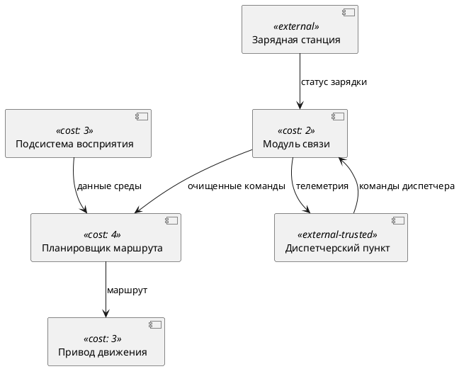

# Конструктор СКИБ — техническое задание

> Версия 0.01.01 от 10.11.2026 · Статус: утверждено, реализовано (v0.01.01) · Назначение: спецификация инструмента · Контекст курса: ГОСТ Р 72118-2025, ГОСТ ISO/IEC TS 19249-2021
>
> Ревизия 0.01.01 (10.11.2026): добавлены модель доверия доменов и целостности потоков (раздел 3.5), коэффициенты доверия в формуле стоимости (разделы 3.3, 7.1), внешние (смежные) системы и рамка периметра (разделы 3.1, 3.5, 6.1, 6.3, 6.4), перестановка панелей и переключение темы интерфейса (раздел 5), два демонстрационных примера — «Автономный коммунальный робот» и «Безэкипажное судно-доставщик» (раздел 14.4, Приложения А–В), unit-кейсы T-T-01…T-T-10 и обновлённые T-C (раздел 11.2); базовый образ сборки — node:22-alpine (раздел 10.2). История решений — Приложение Г (D14–D18).

## 1. Общие сведения

### 1.1. Наименование

Рабочее наименование инструмента — «Конструктор СКИБ» (рабочее имя репозитория и артефактов сборки — `skib-lab`). Аббревиатура СКИБ соответствует предмету курса — «системы с конструктивной информационной безопасностью» (по наименованию ГОСТ Р 72118-2025). Наименование рабочее и может быть изменено правообладателем без пересмотра остальных требований.

### 1.2. Назначение и цели создания

Разрабатывается интерактивный веб-инструмент без серверной части для практических занятий по проектированию систем с конструктивной информационной безопасностью. Студент загружает пример функциональной архитектуры, размещает функции безопасности (карточки) по доменам безопасности (функциональным блокам), наблюдает мгновенный пересчёт стоимости каждого домена и всей системы, а также светофор покрытия целей безопасности, выполняет декомпозицию доменов и оценивает, как изоляция влияет на стоимость решения. Результат работы сохраняется и сдаётся файлом рабочего состояния.

Цели создания инструмента:

1. наглядно связать три сущности курса: цели безопасности, функции безопасности и архитектурные домены;
2. дать численно ощутимую модель «цена безопасности» на основе формулы стоимости раздела 3.3;
3. автоматизировать проверку полноты покрытия целей безопасности (светофор красный — жёлтый — зелёный);
4. поддержать полный учебный цикл: выдача варианта преподавателем, проектирование студентом, сохранение и сдача результата файлом.

Методологический контекст курса — ГОСТ Р 72118-2025 «Защита информации. Системы с конструктивной информационной безопасностью. Методология разработки» и ГОСТ ISO/IEC TS 19249-2021 (каталог архитектурных и дизайнерских принципов построения защищённых систем); понятия zero trust и MILS используются как теоретическая рамка занятий. Решение D9 (Приложение Г): сами стандарты в интерфейс инструмента не включаются, ссылки на них допустимы только в документации.

### 1.3. Пользователи и роли

| Роль | Основные задачи | Документ по роли (раздел 12) |
| --- | --- | --- |
| Студент (пользователь) | Проектирование: загрузка варианта, размещение карточек, декомпозиция, сдача работы | docs/user-guide.md |
| Преподаватель | Подготовка файлов варианта (architecture.yaml, security.yaml), проведение занятия, проверка сданных работ | docs/teacher-guide.md |
| Разработчик | Развитие кода инструмента, сборка, релизы | docs/developer-guide.md |
| Тестировщик | Запуск и расширение автотестов, регистрация дефектов | docs/testing-guide.md |
| Администратор (инженер по развёртыванию) | Развёртывание и сопровождение: Docker, статический хостинг, обновление версии | docs/deployment-guide.md |

### 1.4. Границы разработки

В версии 1.0 не реализуются: серверная часть и база данных, многопользовательский режим и одновременное совместное редактирование, интеграция с системами управления обучением (LMS), мобильная вёрстка, серверная обработка загружаемых файлов. Все перечисленные ограничения могут пересматриваться в версиях v1 и v2 (раздел 13).

## 2. Термины, определения и обозначения

Термины используются во всём документе в единственном значении, приведённом ниже; идентификаторы сущностей в коде и файлах данных заданы в разделе 3.1.

| Термин | Определение |
| --- | --- |
| Функциональный блок | Элемент загруженной функциональной архитектуры; в модели инструмента — узел канвы со стоимостью реализации. |
| Домен безопасности | Тот же объект модели, что функциональный блок, рассматриваемый как изолируемая единица. В интерфейсе — «домен». Синонимы по решению D1. |
| Цель безопасности | Проверяемое свойство системы (конфиденциальность, целостность, доступность и т. п.); определяется в security.yaml. |
| Функция безопасности | Конкретный защитный механизм с числовой стоимостью реализации (решение D1, D3); определяются в security.yaml. |
| Карточка | Визуальное представление функции безопасности в пуле и внутри домена. |
| Пул карточек | Перечень всех функций security.yaml с индикацией статуса размещения. |
| Размещение | Факт нахождения функции ровно в одном домене (правило 3.2). |
| Покрытие цели | Полнота размещения функций, привязанных к цели; правила — в разделе 3.4. |
| Светофор | Индикация статуса покрытия: красный, жёлтый, зелёный. |
| Декомпозиция | Замена домена группой доменов того же уровня (плоская модель, решение D5). Только для внутренних доменов (3.5). |
| Внешняя (смежная) система | Объект модели с признаком `external`: взаимодействует с целевой системой, но находится вне её периметра (3.5); функций не получает, декомпозиции не подлежит, стоимость не определяется. |
| Периметр целевой системы | Граница, охватывающая только внутренние домены; на канве отображается рамкой (3.5). |
| ТКБ (доверенная вычислительная база) | Множество доменов, содержащих хотя бы одну функцию, критичную хотя бы для одной цели безопасности (3.5). |
| НДБ | Недоверенный домен: внутренний домен вне ТКБ; полупрозрачная красная заливка (3.5). |
| ДДБ | Доверенный домен безопасности: домен из ТКБ, все входящие стрелки зелёные (или входов нет); зелёная заливка (3.5). |
| ДДБПЦД | Доверенный домен, повышающий целостность данных: домен из ТКБ, в который входит хотя бы одна красная стрелка; жёлтая заливка (3.5). |
| Целостность потока | Признак стрелки: зелёная — высокоцелостный поток из доверенного источника; красная — низкоцелостный поток (3.5). |
| Стоимость домена | Величина C_домена по формуле раздела 3.3. |
| Стоимость системы | Сумма стоимостей всех доменов, C_системы. |
| Вес связи | Атрибут связи «функция — цель»: mandatory (обязательная) или optional (необязательная), решение D4. |
| architecture.yaml | Файл описания функциональной архитектуры (раздел 6.1). |
| security.yaml | Файл описания целей и функций безопасности (раздел 6.2). |
| state.yaml | Файл рабочего состояния — полный снимок сеанса студента (раздел 6.4). |
| PlantUML | Текстовый формат диаграмм; в инструменте поддерживается фиксированное подмножество (раздел 6.3). |

Обозначения: C_блока — стоимость реализации блока; C_функции — стоимость реализации функции; S — сумма стоимостей функций, размещённых в домене; E_вх, E_исх — число входящих и исходящих стрелок домена; M — множитель связности; все стоимости измеряются в условных единицах стоимости и являются целыми числами.

## 3. Модель предметной области

### 3.1. Сущности и атрибуты

Модель данных состоит из шести сущностей. Имена полей фиксированы и используются в коде, файлах данных и схемах валидации без изменений.

| Сущность | Поле | Тип | Обязательность | Описание |
| --- | --- | --- | --- | --- |
| Block (блок / домен) | id | string | да | Уникальный идентификатор, шаблон `^[a-z][a-z0-9-]{0,63}$` |
| Block | name | string | да | Отображаемое имя, 1–80 символов |
| Block | cost | integer | да | C_блока, целое число не меньше 0 |
| Block | position | {x: number, y: number} | нет | Координаты узла на канве; при отсутствии назначаются автоматически |
| Block | external | boolean | нет | Внешняя (смежная) система — вне периметра целевой системы (3.5); по умолчанию false |
| Block | trusted | boolean | нет | Доверенность внешней системы (3.5); по умолчанию false; для внутренних доменов не используется — их доверенность выводится из размещённых функций |
| Edge (стрелка) | id | string | да | Уникальный идентификатор, тот же шаблон |
| Edge | from | string (Block.id) | да | Источник стрелки |
| Edge | to | string (Block.id) | да | Приёмник стрелки; `from` не равно `to` |
| Edge | label | string | нет | Подпись стрелки, до 60 символов |
| Goal (цель) | id | string | да | Тот же шаблон идентификатора |
| Goal | name | string | да | Отображаемое имя, 1–80 символов |
| Goal | description | string | нет | Пояснение, до 500 символов |
| SecurityFunction (функция) | id | string | да | Тот же шаблон идентификатора |
| SecurityFunction | name | string | да | Отображаемое имя, 1–100 символов |
| SecurityFunction | cost | integer | да | C_функции, целое число не меньше 0 |
| SecurityFunction | implements | массив связей | нет | Связи «функция — цель»: {goal: Goal.id, weight: mandatory \| optional} |
| Placement (размещение) | function | string (SecurityFunction.id) | да | Размещённая функция |
| Placement | block | string (Block.id) | да | Домен размещения |
| Project | architecture | {blocks: Block[], edges: Edge[]} | да | Текущая архитектура |
| Project | security | {goals: Goal[], functions: SecurityFunction[]} | да | Цели и функции |
| Project | assignments | Placement[] | да | Размещения; не более одного на функцию |

Ограничения целостности модели: идентификаторы уникальны в пределах своего типа; в Project обязателен минимум 1 блок, 1 цель и 1 функция (решение зафиксировано, чтобы исключить вырожденные состояния); функция может не иметь связей с целями (предупреждение W-004); цель может не иметь реализующих функций (предупреждение W-003, такая цель всегда красная); граф архитектуры допускает циклы длиной больше одного ребра, петли (E-104) запрещены.

Ограничения для внешних систем (3.5 v0.01.01): C_блока внешней системы фиксирован нулём и не редактируется; функции не размещаются во внешних системах; декомпозиция к ним не применяется; доверенность переключается в инспекторе только у внешних систем.

### 3.2. Правило единственного размещения

Функция безопасности в каждый момент времени размещена ровно в одном домене либо находится в пуле. Перетаскивание карточки из пула в домен создаёт размещение; перетаскивание из домена в домен перемещает его; кнопка «Убрать» возвращает функцию в пул и удаляет размещение. Повторное размещение той же функции в другой домен всегда означает перемещение, а не копирование. Это правило обеспечивает однозначность расчёта стоимости и покрытия.

### 3.3. Модель стоимости (решение D2)

Стоимости всех объектов — целые числа в условных единицах. Расчёт выполняется по формуле:

```
C_домена = C_блока × S_eff × M × K,
    где S = сумма C_функции всех функций, размещённых в домене;
    S_eff = S, если S > 0; иначе 1;
    M = (E_вх + E_исх) / 2,  если (E_вх + E_исх) >= 2;
    M = 1,                   если (E_вх + E_исх) < 2 (применяется только при S > 0);
    K — коэффициент доверия домена по разделу 3.5 v0.01.01;
C_домена = C_блока × K, если S = 0 (домен без размещённых функций);
C_системы = сумма C_домена по всем внутренним доменам; внешние системы
в расчёте стоимости разработки не участвуют: их стоимость не определяется
и не отображается (3.5 v0.01.01).
```

Коэффициенты доверия K (v0.01.01, раздел 3.5):

| Класс домена | K | Смысл |
| --- | --- | --- |
| НДБ (недоверенный) | 0.1 | Дешёвый, но гарантий не даёт |
| ДДБ (доверенный) | 5 | Введён в ТКБ, входы высокоцелостные |
| ДДБПЦД (доверенный, повышающий целостность) | 10 | Введён в ТКБ при низкоцелостных входах |

Правила применения формулы:

1. Результат произведения округляется вверх до целого (ceil); округление выполняется один раз, на итоговом произведении.
2. Домен без размещённых функций стоит C_блока × K независимо от числа его стрелок.
3. Изменение любого входа (стрелки, C_блока, состав или стоимость размещённых функций, доверенность) мгновенно пересчитывает стоимость затронутых доменов и C_системы.
4. Декомпозиция не компенсируется: сумма стоимостей дочерних доменов может отличаться от стоимости исходного домена. Это свойство модели демонстрируется студенту как цена изоляции (решение D5).
5. Отрицательные и дробные стоимости в файлах данных запрещены (коды ошибок E-102, E-207).
6. Внешние системы (external) в формуле не участвуют: им не назначаются функции, их C_блока равен 0 и не отображается (3.5 v0.01.01).

Зависимость множителя M от суммарного числа стрелок E:

| E = E_вх + E_исх | 0 | 1 | 2 | 3 | 4 | 5 | 6 | 7 | 8 |
| --- | --- | --- | --- | --- | --- | --- | --- | --- | --- |
| M | 1 | 1 | 1 | 1.5 | 2 | 2.5 | 3 | 3.5 | 4 |

### 3.4. Правила покрытия целей (решение D4)

Для цели t обозначим: M(t) — множество функций, связанных с целью весом mandatory; O(t) — множество функций, связанных весом optional; функция считается размещённой, если для неё существует Placement. Статус цели вычисляется по правилам:

| Условие | Статус |
| --- | --- |
| Цель не имеет ни одной связанной функции | Красный (и предупреждение W-003) |
| M(t) непусто, размещены все функции M(t) | Зелёный |
| M(t) непусто, m < \|M(t)\| и размещена хотя бы одна функция из M(t) ∪ O(t) | Жёлтый |
| M(t) непусто, ни одна функция из M(t) ∪ O(t) не размещена | Красный |
| M(t) пусто, O(t) непусто, размещены все функции O(t) | Зелёный |
| M(t) пусто, O(t) непусто, размещена часть функций O(t) | Жёлтый |
| M(t) пусто, O(t) непусто, не размещена ни одна | Красный |

Дополнительные правила агрегирования:

1. Статус системы: красный, если есть хотя бы одна красная цель; иначе жёлтый, если есть хотя бы одна жёлтая; иначе зелёный.
2. Статус домена: агрегат по целям всех функций, размещённых в домене; зелёный, если все эти цели зелёные; красный, если хотя бы одна красная; иначе жёлтый. Домен без размещённых функций — нейтральный (серый), на его статус влияние не оказывается.
3. Карточка функции показывает точечные индикаторы по каждой связанной с ней цели; цвет точки равен текущему статусу этой цели.
4. Необязательные функции (optional) не могут дать цели зелёный статус, пока не размещены все обязательные: они влияют только на жёлтый статус.

### 3.5. Модель доверия доменов и целостности потоков (v0.01.01)

Внутренние домены (без признака `external`) классифицируются по доверию; внешние системы классифицируются по явному признаку `trusted`. Класс внутреннего домена выводится автоматически из размещённых функций и цветов входящих стрелок — вручную он не назначается.

1. ТКБ (доверенная вычислительная база) — множество внутренних доменов, в которых размещена хотя бы одна функция, критичная хотя бы для одной цели безопасности. Функция считается критичной, если у неё есть хотя бы одна связь `implements` с целью (любой вес; решение D4 раздела 3.4).
2. Классы внутренних доменов:

| Класс | Условие | Заливка узла | K |
| --- | --- | --- | --- |
| НДБ | Домен вне ТКБ (нет ни одной критичной функции) | Полупрозрачная красная, текст чёрный | 0.1 |
| ДДБ | Домен в ТКБ и все входящие стрелки зелёные (в том числе при отсутствии входящих) | Зелёная | 5 |
| ДДБПЦД | Домен в ТКБ и есть хотя бы одна входящая красная стрелка | Жёлтая | 10 |

3. Цвет стрелки определяется доверенностью источника потока: зелёный (высокоцелостный поток) — если источник ДДБ, ДДБПЦД или доверенная внешняя система; красный (низкоцелостный) — во всех остальных случаях, включая потоки из НДБ и недоверенных внешних систем.
4. Внешние системы (признак `external`): недоверенная — по умолчанию, красная заливка, все её исходящие стрелки красные; доверенная (`trusted: true`) — зелёная заливка, исходящие стрелки зелёные. Внешние системы не получают функций, не декомпозируются, в ТКБ и в C_системы не входят.
5. Рамка периметра целевой системы охватывает только внутренние домены; внешние системы располагаются за рамкой. Внешнюю систему нельзя перетащить или создать внутри рамки: позиция выносится за периметр автоматически.
6. Раскраска (классы доменов, цвета стрелок, заливка внешних систем) пересчитывается автоматически после каждой операции и при загрузке файлов вместе со стоимостью и покрытием (Ф-18) — ручного обновления не требуется.

## 4. Функциональные требования

### 4.1. Загрузка данных

- **Ф-1.** Загрузка файла `architecture.yaml` через диалог выбора файла. Архитектура заменяет текущую; все размещения сбрасываются в пул. Если на канве есть размещения или правки, инструмент запрашивает подтверждение замены.
- **Ф-2.** Загрузка файла `security.yaml` через диалог выбора файла. Цели и функции заменяются; пул карточек перечитывается из нового списка; размещения функций, отсутствующих в новом списке, удаляются; размещения сохранившихся функций сохраняются, если целевые блоки существуют.
- **Ф-3.** Загрузка архитектуры в формате PlantUML (фиксированное подмножество раздела 6.3) выполняет те же действия, что Ф-1.
- **Ф-4.** Загрузка файла `state.yaml` восстанавливает полный сеанс: архитектуру, цели и функции, размещения. Замена выполняется целиком после подтверждения.
- **Ф-5.** Кнопка «Демо-проект» открывает выбор одного из двух демонстрационных примеров — «Автономный коммунальный робот» (14.4.1) и «Безэкипажное судно-доставщик» (14.4.2) — и загружает его одной командой, без подтверждения, если проект пуст.
- **Ф-6.** Каждый входной файл валидируется по разделу 6.5 до применения. При обнаружении ошибок загрузка отменяется целиком, текущий проект не изменяется, пользователю показывается список ошибок с кодами и номерами строк.

### 4.2. Пул карточек и размещения

- **Ф-7.** Пул карточек отображается на левой панели: имя, стоимость, точечные индикаторы целей, статус («свободна» либо «в: имя домена»). Фильтры статуса: «все», «свободные», «размещённые». Поиск по имени — в v1.
- **Ф-8.** Перетаскивание карточки мышью из пула в домен создаёт размещение (HTML5 drag and drop, целевой объект — узел домена). Отпускание карточки вне домена отменяет операцию.
- **Ф-9.** Перемещение функции из домена в домен: в v0 — через инспектор домена (выпадающий список «Переместить в…»), в v1 — прямым перетаскиванием карточки между узлами.
- **Ф-10.** Кнопка «Убрать» у карточки внутри домена возвращает функцию в пул.
- **Ф-11.** В пуле и в домене отображаются одни и те же данные карточки; переключение статуса происходит после каждой операции без ручного обновления.

### 4.3. Домены, стрелки и декомпозиция

- **Ф-12.** Канва React Flow отображает домены узлами. Узел внутреннего домена показывает: имя, класс доверия (НДБ, ДДБ, ДДБПЦД), C_блока, список размещённых карточек (у каждой — кнопка «Убрать»), значения S, M, K и C_домена, цветной индикатор статуса домена, кнопку «Декомпозировать» (только для внутренних доменов). Узел внешней системы (3.5) показывает имя, признак «внешняя», состояние доверенности и переключатель доверенности; стоимость не отображается.
- **Ф-13.** Кнопка «+ Домен» добавляет пустой внутренний домен (C_блока по умолчанию 1, имя «Новый домен», автоматически уникальный id). Кнопка «+ Внешняя система» добавляет внешнюю систему (3.5): признак `external`, по умолчанию недоверенная, C_блока 0, позиция — за рамкой периметра. Параметры редактируются в инспекторе.
- **Ф-14.** Новая стрелка создаётся перетаскиванием от порта узла-источника к порту узла-приёмника; подпись вводится в инспекторе стрелки. Удаление стрелки — выделением и клавишей Delete либо кнопкой в инспекторе.
- **Ф-15.** Удаление домена выполняется из инспектора с подтверждением; вместе с доменом удаляются его стрелки, размещённые функции возвращаются в пул.
- **Ф-16.** Кнопка «Декомпозировать» открывает диалог: число дочерних доменов k от 2 до 6; для каждого потомка — имя (по умолчанию «<имя исходного>.N») и C_блока (по умолчанию 1); каждой стрелке исходного домена назначается один потомок (выпадающий список, по умолчанию первый). При применении: исходный домен удаляется, потомки добавляются на тот же уровень (плоская модель D5), стрелки переподключаются по назначению, все функции исходного домена возвращаются в пул, выполняется пересчёт, операция записывается в историю.
- **Ф-17.** Ограничения модели: не более 200 доменов, не более 500 стрелок; при превышении операции блокируются с сообщением.

### 4.4. Расчёты и индикация

- **Ф-18.** После каждой операции мгновенно пересчитываются: C_домена каждого внутреннего домена, C_системы, статусы всех целей, статусы доменов, статус системы, классы доверия доменов и цвета стрелок (3.5); порог отклика — 100 мс (раздел 9).
- **Ф-19.** Панель целей отображается на левой панели под пулом карточек (5.1 v0.01.01): список всех целей со светофором и составом — обязательные и необязательные функции цели с отметками размещения.
- **Ф-20.** Панель расчёта системы в правой панели под инспектором (5.1 v0.01.01, шрифты крупнее базовых): C_системы, число внутренних доменов и внешних систем, «размещено X из Y функций», «покрыто целей Z из N», статус системы, разбивка доменов по классам доверия с коэффициентами (НДБ ×0.1, ДДБ ×5, ДДБПЦД ×10).

### 4.5. История операций

- **Ф-21.** Отмена и повтор операций (Ctrl+Z / Ctrl+Y), глубина истории не менее 100 шагов. История охватывает: размещение, перемещение, удаление карточек; декомпозицию; добавление и удаление доменов и стрелок; правку имён, стоимостей и подписей.

### 4.6. Сохранение и экспорт

- **Ф-22.** Автосохранение текущего проекта в localStorage (ключ `skib-lab-state-v1`) после каждой операции с задержкой не более 1 с; восстановление при повторном открытии страницы.
- **Ф-23.** Кнопка «Сбросить проект» очищает localStorage и возвращает инструмент к пустому состоянию, с подтверждением.
- **Ф-24.** Экспорт файлов: `state.yaml` — полный снимок сеанса (раздел 6.4); `architecture.yaml` — текущие блоки и стрелки с координатами; `architecture.puml` — та же архитектура в PlantUML. Файлы скачиваются средствами браузера.
- **Ф-25.** Импорт `state.yaml` (Ф-4) заменяет весь проект после подтверждения.

### 4.7. Сообщения и обработка ошибок

- **Ф-26.** Все сообщения об ошибках валидации показываются на панели валидации в верхнем правом углу с кодом, понятным текстом на русском языке и, если применимо, номером строки файла; например: «E-102: стоимость блока blk-link отрицательная (строка 12)».
- **Ф-27.** Предупреждения (W-код) не блокируют загрузку и показываются отдельным списком; ошибки (E-код) блокируют применение файла (Ф-6).
## 5. Требования к интерфейсу пользователя

### 5.1. Компоновка окна

Рабочая область фиксированная (без мобильной вёрстки), минимальное разрешение 1280×720. Экран состоит из четырёх зон:

| Зона | Расположение | Содержимое |
| --- | --- | --- |
| Верхняя панель | Сверху, высота 48 px | Кнопки: «Загрузить архитектуру…», «Загрузить цели и функции…», «Открыть состояние…», «Демо-проект» (выбор примера 14.4.1/14.4.2), «+ Домен», «+ Внешняя система», «Экспорт» (раскрывающийся список: architecture.yaml, PlantUML, state.yaml), «Сбросить проект», «Отменить», «Вернуть», переключатель темы (светлая/тёмная, по умолчанию тёмная); индикатор статуса валидации (чистый / предупреждения / ошибки) |
| Левая панель | Слева, ширина 320 px | Пул карточек (верх): карточки функций, фильтры статуса, счётчик «свободных/всего»; панель целей безопасности (низ, 5.1 v0.01.01) — светофор и состав каждой цели |
| Канва | Центр | Узлы-домены и внешние системы (React Flow), рамка периметра целевой системы (3.5), стрелки, масштабирование 25–200 %, панорамирование |
| Правая панель | Справа, ширина 340 px | Инспектор: свойства выбранного объекта (домен, карточка, стрелка, внешняя система); под инспектором — панель расчёта системы (5.1 v0.01.01): C_системы, покрытие целей, размещения, разбивка доменов по классам доверия, статус системы — шрифты крупнее базовых |

Тема интерфейса (5.1 v0.01.01): тёмная по умолчанию; переключатель в верхней панели переводит светлый/тёмный режим без перезагрузки страницы; выбор сохраняется в localStorage (ключ `skib-theme`) и применяется до гидратации (без вспышки светлого фона). Все цвета интерфейса заданы токенами и адаптированы для обеих тем.

### 5.2. Узел домена и карточка

Узел внутреннего домена — прямоугольник не менее 240×120 px: заголовок с именем, меткой класса доверия (НДБ / ДДБ / ДДБПЦД) и цветной точкой статуса, строка «Блок: C_блока · S: сумма · M: множитель · K: коэффициент доверия», строка «Домен: C_домена» полужирным шрифтом, кнопка «Декомпозировать» в правом верхнем углу, внутри узла перечисляются карточки размещённых функций. Узел внешней системы — за рамкой периметра: имя, признак «внешняя», состояние доверенности («доверенная»/«недоверенная») с переключателем; стоимость не отображается. Заливка узлов — по классу доверия (3.5, 5.3). Карточка — строка с именем, стоимостью, точечными индикаторами целей и кнопкой «Убрать». При выборе домена, карточки, стрелки или внешней системы инспектор показывает полные свойства и доступные действия.

### 5.3. Цветовая система статусов

Цвета фиксированы токенами; к каждому статусу прилагается не только цвет, но и графический либо текстовый признак (доступность для людей с нарушением восприятия цвета):

| Статус | Цвет | Признак-дублёр |
| --- | --- | --- |
| Красный (цель не покрыта) | #D32F2F | Иконка «крест» и подпись «не покрыта» |
| Жёлтый (частично) | #F9A825 | Иконка «половина круга» и подпись «частично» |
| Зелёный (полностью) | #43A047 | Иконка «галочка» и подпись «полностью» |
| Нейтральный (домен без функций) | #9E9E9E | Подпись «нет функций» |

Цвета доверия (3.5 v0.01.01) — заливка узлов и цвет стрелок; к каждому также прилагается текстовый признак:

| Элемент | Цвет | Признак-дублёр |
| --- | --- | --- |
| НДБ / недоверенная внешняя система | Полупрозрачная красная заливка | Метка «НДБ» либо «недоверенная» |
| ДДБ / доверенная внешняя система | Зелёная заливка | Метка «ДДБ» либо «доверенная» |
| ДДБПЦД | Жёлтая заливка | Метка «ДДБПЦД» |
| Стрелка высокоцелостного потока | Зелёная линия | Подпись потока у узла-приёмника |
| Стрелка низкоцелостного потока | Красная линия | Подпись потока у узла-приёмника |
| Рамка периметра | Штриховая рамка с подписью «Периметр целевой системы» | Заголовок рамки |

Язык интерфейса — русский; все строки интерфейса собраны в едином модуле словаря `src/i18n/ru.ts` (без строк, разбросанных по компонентам), что обеспечивает готовность к локализации в v1.

## 6. Спецификация форматов данных

### 6.1. Файл architecture.yaml

Кодировка UTF-8, размер не более 5 МБ. Схема полей:

| Поле | Тип | Обязательность | Описание |
| --- | --- | --- | --- |
| version | integer | да | Значение 1 |
| system.name | string | нет | Имя системы, до 100 символов |
| system.description | string | нет | Описание, до 500 символов |
| blocks | array | да | Не менее 1 блока |
| blocks[].id | string | да | Уникальный, `^[a-z][a-z0-9-]{0,63}$` |
| blocks[].name | string | да | Имя блока, 1–80 символов |
| blocks[].cost | integer | да | C_блока, не меньше 0; для внешних систем фиксируется нулём |
| blocks[].position | object | нет | {x, y} — целые числа |
| blocks[].external | boolean | нет | Признак внешней (смежной) системы (3.5); по умолчанию false |
| blocks[].trusted | boolean | нет | Доверенность внешней системы (3.5); по умолчанию false |
| edges | array | да | Допустим пустой массив |
| edges[].id | string | да | Уникальный, тот же шаблон |
| edges[].from, edges[].to | string | да | Существующие id блоков; from не равно to |
| edges[].label | string | нет | Подпись, до 60 символов |

Пример (сокращённый; полный демонстрационный файл примера 1 — Приложение А):

```yaml
version: 1
system:
  name: "Автономный коммунальный робот"
blocks:
  - id: blk-link
    name: "Модуль связи"
    cost: 2
    position: { x: 420, y: 340 }
  - id: ext-ctrl
    name: "Диспетчерский пункт"
    cost: 0
    external: true
    trusted: true
    position: { x: 1180, y: 120 }
edges:
  - id: e-disp-link
    from: ext-ctrl
    to: blk-link
    label: "команды диспетчера"
```

### 6.2. Файл security.yaml

Кодировка UTF-8, размер не более 5 МБ. Схема полей:

| Поле | Тип | Обязательность | Описание |
| --- | --- | --- | --- |
| version | integer | да | Значение 1 |
| goals | array | да | Не менее 1 цели |
| goals[].id | string | да | Уникальный, `^[a-z][a-z0-9-]{0,63}$` |
| goals[].name | string | да | Имя цели, 1–80 символов |
| goals[].description | string | нет | Пояснение, до 500 символов |
| functions | array | да | Не менее 1 функции |
| functions[].id | string | да | Уникальный, тот же шаблон |
| functions[].name | string | да | Имя функции, 1–100 символов |
| functions[].cost | integer | да | C_функции, не меньше 0 |
| functions[].implements | array | нет | Связи «функция — цель» |
| functions[].implements[].goal | string | да | Существующий id цели |
| functions[].implements[].weight | string | да | `mandatory` или `optional` |

Пример (сокращённый; полный демонстрационный файл примера 1 — Приложение Б):

```yaml
version: 1
goals:
  - id: g-cmd
    name: "Достоверность команд"
functions:
  - id: fn-auth
    name: "Аутентификация команд диспетчера"
    cost: 3
    implements:
      - { goal: g-cmd, weight: mandatory }
```

### 6.3. Представление архитектуры в PlantUML

Поддерживается фиксированное подмножество синтаксиса PlantUML (решение D7). Стоимость блока записывается в стереотипе `<<cost: N>>`; внешние системы — стереотипами `<<external>>` (недоверенная) и `<<external-trusted>>` (доверенная, 3.5 v0.01.01). Грамматика подмножества:

```
файл       ::= "@startuml" { строка } "@enduml"
строка     ::= объявление | связь | игнорируемая-строка
объявление ::= "[" имя "]" [ "<<cost:" число ">>" | "<<external>>" | "<<external-trusted>>" ]
связь      ::= "[" имя "]" ( "-->" | "->" ) "[" имя "]" [ ":" подпись ]
```

Правила разбора: имена компонентов уникальны (E-302) и сопоставляются блокам по полю name; компонент без стереотипа стоимости получает C_блока = 0 с предупреждением; компонент со стереотипом `<<external>>` или `<<external-trusted>>` — внешняя система (C_блока 0, признак external, trusted — только для external-trusted); стрелка на необъявленный компонент — ошибка E-303; отсутствие @startuml или @enduml — ошибка E-304; строки, не входящие в подмножество (skinparam, note, package, title, алиасы `as`), пропускаются с предупреждением W-002 при первом вхождении каждого типа конструкции; ошибка разбора строки — E-301 с номером строки. Экспорт в PlantUML выполняется по той же грамматике, порядок блоков — порядок их объявления в модели. Полный демонстрационный файл — Приложение В.

### 6.4. Файл рабочего состояния state.yaml

Файл самодостаточен: содержит архитектуру, цели и функции и размещения, поэтому сдача работы одним файлом полностью описывает решение студента (решение D8).

| Поле | Тип | Обязательность | Описание |
| --- | --- | --- | --- |
| version | integer | да | Значение 1; иное значение — ошибка E-401 |
| architecture | object | да | Та же схема, что architecture.yaml, включая position |
| security | object | да | Та же схема, что security.yaml |
| assignments | array | да | Размещения {function, block}; оба id обязаны существовать (E-402) |
| meta.savedAt | string | нет | Момент сохранения в формате ISO 8601 |
| meta.source | string | нет | Происхождение проекта (имена исходных файлов) |

Пример структуры:

```yaml
version: 1
architecture:
  blocks: [ ... ]      # включая external: true / trusted: true для внешних систем
  edges: [ ... ]
security:
  goals: [ ... ]
  functions: [ ... ]
assignments:
  - { function: fn-auth, block: blk-link }
meta:
  savedAt: "2026-11-10T12:00:00Z"
  source: "architecture.yaml + security.yaml"
```

### 6.5. Валидация входных файлов

Валидация выполняется в фиксированном порядке: 1) синтаксический разбор YAML; 2) проверка схемы (библиотека zod) — типы, обязательность, диапазоны; 3) проверка ссылочной целостности и уникальности; 4) семантические предупреждения. Ошибка любого шага останавливает валидацию и блокирует применение файла (Ф-6). Итог проверки — объект {errors: [{code, message, path?, line?}], warnings: [...]}.

| Код | Значение |
| --- | --- |
| E-001 | Файл не является корректным YAML (с номером строки из парсера) |
| E-002 | Структура не соответствует схеме: отсутствует обязательное поле или неверный тип (с путём к полю) |
| E-101 | Дубликат id блока |
| E-102 | Стоимость блока вне диапазона (не целое число или меньше 0) |
| E-103 | Стрелка ссылается на несуществующий блок |
| E-104 | Петля: from равно to |
| E-105 | Список blocks пуст |
| E-106 | id не соответствует шаблону `^[a-z][a-z0-9-]{0,63}$` |
| E-201 | Дубликат id цели |
| E-202 | Дубликат id функции |
| E-203 | Список goals пуст |
| E-204 | Список functions пуст |
| E-205 | Связь implements ссылается на несуществующую цель |
| E-206 | Вес связи отличен от mandatory и optional |
| E-207 | Стоимость функции вне диапазона |
| E-301 | Строка PlantUML не распознана (с номером строки) |
| E-302 | Дубликат имени компонента в PlantUML |
| E-303 | Стрелка ссылается на необъявленный компонент |
| E-304 | Отсутствует @startuml или @enduml |
| E-401 | state.yaml: неподдерживаемая версия (version не равен 1) |
| E-402 | state.yaml: placement ссылается на отсутствующую функцию или блок |
| E-403 | state.yaml: отсутствует обязательный раздел (architecture, security, assignments) |
| W-001 | Неизвестные поля игнорируются (с перечнем путей) |
| W-002 | PlantUML: неподдерживаемая конструкция пропущена (тип конструкции) |
| W-003 | Цель не имеет реализующих функций (всегда красная) |
| W-004 | Функция не имеет связей с целями |
| W-005 | Компонент PlantUML без стереотипа стоимости: назначена C_блока = 0 |

### 6.6. Требования к экспорту и обратной загрузке

Экспортированный файл обязан загружаться инструментом обратно без ошибок и давать структурно эквивалентную модель (round-trip): для architecture.yaml и PlantUML эквивалентны блоки, стрелки, стоимости и подписи (координаты position сохраняются в architecture.yaml и не входят в сравнение для PlantUML); для state.yaml эквивалентен весь проект. Порядок ключей и массивов при сравнении не учитывается. Это требование проверяется автотестами (T-Y-10, T-S-01) и входит в приёмочный чек-лист (14.2).

## 7. Алгоритмы

### 7.1. Расчёт стоимости

Алгоритм выполняется после каждой операции (Ф-18) и при загрузке файлов; на тех же данных работает алгоритм доверия 3.5 (пересчёт раскраски). Сложность O(|B| + |F| + |E|).

```
функция domainCost(block, funcsIn, eIn, eOut, K):
    S = сумма cost всех funcsIn
    если S == 0:
        вернуть ceil(block.cost * K)            # домен без функций
    E = eIn + eOut
    M = (E / 2), если E >= 2, иначе 1
    вернуть ceil(block.cost * S * M * K)        # округление вверх, один раз

функция recalcCosts(project):
    trust = computeTrust(project)               # 3.5 v0.01.01: классы доменов и цвета стрелок
    для каждого внутреннего блока b:
        C[b] = domainCost(b, функции в b, число входящих,
                          число исходящих стрелок, K[b] из trust)
    для каждой внешней системы: стоимость не определяется (не отображается)
    C_system = сумма C по всем внутренним блокам
```

### 7.2. Расчёт покрытия

```
функция goalStatus(goal, functions, placements):
    M = функции с (goal, mandatory);  O = функции с (goal, optional)
    если M и O пусты:  вернуть RED                  # + предупреждение W-003
    m = число размещённых из M;  o = число размещённых из O
    если M непуст:
        если m == |M|:                  вернуть GREEN
        если (m + o) > 0:               вернуть YELLOW
        иначе:                          вернуть RED
    если o == |O|:                      вернуть GREEN
    если o > 0:                         вернуть YELLOW
    вернуть RED

функция recalcCoverage(project):
    для каждой цели t: status[t] = goalStatus(t, ...)
    для каждого домена d:
        цели всех функций d; пусто -> NEUTRAL,
        иначе: GREEN, если все GREEN; RED, если есть RED; иначе YELLOW
    status_system = RED, если есть RED; иначе YELLOW, если есть YELLOW; иначе GREEN
```

### 7.3. Декомпозиция домена

```
функция decompose(project, blockId, children, edgeAssign):
    # children: массив из k (2..6) записей {name, cost}; edgeAssign: каждой стрелке
    # исходного домена назначен ровно один потомок
    проверки (до применения, модель не изменяется при отказе):
        blockId существует; 2 <= k <= 6;
        имена потомков непустые и не совпадают с именами других блоков;
        cost каждого потомка — целое >= 0;
        каждая стрелка blockId присутствует в edgeAssign ровно один раз
    транзакция (восстанавливается по undo):
        снять все размещения функций blockId -> вернуть функции в пул
        удалить blockId и его стрелки
        добавить потомков (position: рядом с исходным доменом, со смещением)
        создать стрелки потомков по edgeAssign (сохраняя подписи и направление)
    пересчитать стоимости и покрытие; записать шаг в историю
```

Повторная декомпозиция полученных доменов разрешена: плоская модель не имеет понятия глубины (D5), единственное ограничение — лимит числа доменов (Ф-17).

### 7.4. Валидация файлов

Порядок и правила валидации — в разделе 6.5. Каждый код ошибки имеет единственное место возникновения; сообщения формируются из таблицы кодов, без конкатенации произвольных технических текстов.

## 8. Технические требования

### 8.1. Технологический стек (решение D6)

| Компонент | Выбор | Назначение |
| --- | --- | --- |
| Язык | TypeScript 5, режим strict | Весь код проекта |
| Платформа | Next.js 16 (App Router, статический экспорт `output: "export"`), Turbopack | Сборка статического каталога `out/`, dev-сервер |
| Среда исполнения | Node.js 22+ (базовый образ node:22-alpine) | Требование vitest 5 и toolchain сборки; устраняет предупреждения EBADENGINE (решение D18) |
| UI | React 19 | Компоненты интерфейса |
| Канва | React Flow (@xyflow/react 12) | Узлы, стрелки, перетаскивание |
| Разбор YAML | js-yaml 5 | Парсинг architecture.yaml, security.yaml, state.yaml |
| Схемы | zod 4 | Валидация структур (раздел 6.5) |
| Состояние | zustand 5 | Хранилище проекта и история операций |
| Unit-тесты | Vitest 5 (покрытие v8) | Тесты движка и парсеров |
| E2E-тесты | Playwright 1.65 | Сценарии раздела 11.3 |
| Качество кода | ESLint 9 (включая react-hooks), Prettier | Линт и форматирование |

### 8.2. Слои приложения и запреты

Код разделён на слои с односторонними зависимостями: `src/engine` — чистые функции модели, стоимости, покрытия, декомпозиции (без доступа к DOM, localStorage и сети); `src/io` — парсеры и сериализаторы четырёх форматов и zod-схемы (без доступа к React и DOM); `src/store` — хранилище zustand и история операций; `src/ui` — компоненты React (без бизнес-расчётов); `src/i18n` — словарь строк. Приложение не выполняет сетевых запросов к внешним адресам: после первой загрузки страницы оно полностью автономно (раздел 9). Все вычисления и разбор файлов выполняются на клиенте.

### 8.3. Структура репозитория

Полное дерево репозитория приведено в Приложении Д. Обязательные файлы корня: `package.json` с `package-lock.json` (воспроизводимая установка), `next.config.ts`, `vitest.config.ts`, `playwright.config.ts` и `playwright.firefox.config.ts`, `eslint.config.mjs`, `Makefile`, `Dockerfile`, `.dockerignore`, `docker-compose.yml`, `README.md`, `CHANGELOG.md`, каталог `nginx/` с конфигурацией, каталоги `src/`, `tests/`, `docs/`, `samples/`.

## 9. Нефункциональные требования

| ID | Требование |
| --- | --- |
| НФ-1 | Пересчёт стоимостей и покрытия после любой операции — не более 100 мс при максимальной модели (200 доменов, 500 стрелок, 100 функций) |
| НФ-2 | Начальная загрузка страницы — не более 2 с на типовом ноутбуке; объём начального пакета — не более 1 МБ в gzip |
| НФ-3 | Поддерживаемые браузеры: Chromium (Chrome, Edge) и Firefox — две последние мажорные версии; минимальное разрешение 1280×720 |
| НФ-4 | Полная автономия: отсутствие внешних CDN, телеметрии и сетевых запросов после загрузки страницы |
| НФ-5 | Приватность: данные пользователя существуют только в браузере (localStorage) и в экспортированных файлах; сбор и передача данных отсутствуют |
| НФ-6 | Автосохранение и восстановление сеанса после перезагрузки страницы (Ф-22); ошибки загрузки файлов не приводят к потере текущего проекта (Ф-6) |
| НФ-7 | Лимит размера загружаемого файла — 5 МБ; превышение — понятное сообщение, файл не применяется |
| НФ-8 | Локализация: интерфейс на русском языке; строки централизованы в `src/i18n/ru.ts` |
| НФ-9 | Доступность: статусы различимы без опоры только на цвет (раздел 5.3); все кнопки доступны с клавиатуры |
| НФ-10 | Горячие клавиши: Ctrl+Z — отмена, Ctrl+Y — повтор, Delete — удаление выбранной стрелки |
## 10. Требования к развёртыванию

### 10.1. Варианты развёртывания

Инструмент не имеет серверной части, поэтому любой вариант развёртывания сводится к доставке статических файлов. Поддерживаются четыре варианта; рекомендуемый для компьютерного класса и демонстраций — вариант В3 (Docker).

| Вариант | Назначение | Требования к среде | Ограничения |
| --- | --- | --- | --- |
| В1. Статические файлы (dist/) на готовом веб-сервере или CDN | Публикация студентам без Docker: любой веб-сервер, GitHub Pages, S3-совместимое хранилище | Доступ к каталогу публикации | Базовый путь задаётся при сборке (BASE_PATH); пересборка при смене пути |
| В2. Локальный запуск разработчика | Разработка и отладка | Node.js 20+ и npm | Не для эксплуатации; порт 5173 (dev) или 4173 (preview) |
| В3. Локально в Docker-контейнере | Основной способ развёртывания в учебном классе, проверка сборки, приёмка | Docker Engine 24+ (или совместимый Podman 4+) | Порт 8080; серверного состояния нет, данные живут в браузере |
| В4. Веб-сервер организации за обратным прокси | Интеграция в портал вуза в подпапке | nginx/Apache с прокси-правилами | Нужны согласования конфигурации прокси; BASE_PATH при сборке |

Во всех вариантах приложение обращается только к собственным статическим ресурсам; тома, базы данных и служебные контейнеры не требуются. Состояние пользователя хранится в localStorage браузера и привязано к origin: при смене адреса публикации (например, при переходе с В3 на В4) автосохранённые проекты студентов не переносятся — это ограничение указывается в документации администратора.

### 10.2. Требования к Dockerfile

В репозитории обязателен рабочий Dockerfile, собирающий исполняемый образ локально без доступа к сети, кроме загрузки базовых образов и пакетов npm. Обязательные свойства:

1. Многоэтапная сборка: этап builder на базовом образе `node:22-alpine` (установка зависимостей по `package-lock.json` командой `npm ci`, сборка `npm run build`), этап runtime на образе `nginx:1.27-alpine`, копирование статического каталога `out/` в каталог обслуживания nginx. Node 22 (не 20) — требование devDependencies (vitest 5): на Node 20 `npm ci` выводит предупреждения EBADENGINE (решение D18).
2. Наладка `nginx/nginx.conf` из репозитория: прослушивание порта 8080 (непривилегированный); резервный маршрут SPA (`try_files ... /index.html`); endpoint `/healthz` с ответом `200 ok`; сжатие gzip для текстовых типов; заголовки кэширования `Cache-Control: public, max-age=31536000, immutable` для `/assets/` и `Cache-Control: no-cache` для `index.html`; заголовки безопасности `X-Content-Type-Options: nosniff`, `X-Frame-Options: DENY`, `Referrer-Policy: no-referrer`, `Content-Security-Policy: default-src 'self'; style-src 'self' 'unsafe-inline'; img-src 'self' data:` (допуск `unsafe-inline` для стилей связан с инлайновыми стилями React Flow и фиксируется в комментарии к конфигурации).
3. Запуск без привилегий root: конфигурация nginx в режиме непривилегированного пользователя (pid и временные каталоги в /tmp), процесс master не от root.
4. HEALTHCHECK образа: обращение к `http://127.0.0.1:8080/healthz` средствами wget.
5. Аргумент сборки `BASE_PATH` (по умолчанию `/`) передаётся в сборку (`next.config.ts` читает переменную окружения BASE_PATH и задаёт basePath/assetPrefix); значение отличное от корня используется для вариантов В1 и В4.
6. Метаданные OCI (`org.opencontainers.image.title`, `.version`, `.description`); версия инструмента передаётся как `NEXT_PUBLIC_APP_VERSION` и отображается в интерфейсе (для v0.01.01 — 0.01.01).
7. Файл `.dockerignore` исключает как минимум: `node_modules`, `out`, `.next`, `.git`, `tests`, `playwright-report`, `coverage`, `docs`.
8. Целевые показатели: размер образа не более 60 МБ; время сборки на типовой машине не более 5 минут без кэша образов.

Эскиз итоговой конфигурации nginx — Приложение Е.

### 10.3. Требования к Makefile

Makefile — единая точка входа для сборки, тестирования и запуска; каждая цель печатает выполняемые команды; цель без аргументов — `help`. Обязательные цели:

| Цель | Действие |
| --- | --- |
| help (по умолчанию) | Список целей с краткими описаниями |
| install | Установка зависимостей: `npm ci` |
| dev | Запуск dev-сервера Next.js: `npm run dev` (порт задаётся переменной PORT, по умолчанию 3000) |
| build | Производственная сборка: `npm run build` (статический каталог out/) |
| preview | Запуск собранной версии локально: `serve out -s` (порт PORT, по умолчанию 4173) |
| lint | ESLint и проверка типов `tsc --noEmit` |
| test-unit | Unit-тесты Vitest без покрытия |
| test-unit-coverage | Unit-тесты с отчётом покрытия и порогами раздела 11.2 |
| test-e2e | E2E-тесты Playwright (webServer поднимает preview автоматически) |
| test | Последовательное выполнение test-unit и test-e2e |
| check | lint + test (полная локальная проверка перед сдачей) |
| docker-build | Сборка образа: `$(DOCKER) build --build-arg BASE_PATH=$(BASE_PATH) -t $(IMAGE):$(TAG) .` |
| docker-run | Запуск образа на переднем плане: `$(DOCKER) run --rm -p $(PORT):8080 $(IMAGE):$(TAG)` |
| docker-start | Запуск в фоне с именем контейнера skib-lab |
| docker-stop | Остановка и удаление контейнера skib-lab |
| docker-logs | Логи контейнера skib-lab |
| docker-shell | Оболочка sh в контейнере для диагностики |
| clean | Удаление артефактов сборки и отчётов (out, coverage, playwright-report, test-results, .next) |
| distclean | clean + удаление node_modules |

Переменные Makefile: `DOCKER ?= docker` (переопределяется на podman без правки файла), `IMAGE ?= skib-lab`, `TAG ?= 0.01.01`, `PORT ?= 8080` (для контейнерного запуска; тот же PORT передаётся dev-серверу и preview, где по умолчанию 3000 и 4173 соответственно), `BASE_PATH ?= /`. Цели с префиксом docker- проверяют доступность Docker и выводят понятную инструкцию при его отсутствии; цели тестирования не требуют Docker. docker-compose.yml дублирует сценарий В3 для удобства (сервис app: сборка из текущего каталога, публикация `$(PORT):8080`); требования к compose не расширяют требования к Dockerfile.

### 10.4. Конфигурационные параметры

| Параметр | Где действует | По умолчанию | Назначение |
| --- | --- | --- | --- |
| PORT | Makefile (dev, preview, docker-run), docker-compose, webServer E2E-конфигураций | 8080 (docker) / 3000 (dev) / 4173 (preview) | Публикуемый порт хоста; внутренний порт контейнера фиксирован (8080); dev-сервер Next.js слушает `next dev -p ${PORT:-3000}` |
| BASE_PATH | Аргумент сборки Docker, next.config.ts | / | Базовый путь для публикации в подпапке (В1, В4) |
| NEXT_PUBLIC_APP_VERSION | Сборка (Dockerfile) | 0.01.01 | Отображается в интерфейсе |
| IMAGE, TAG, DOCKER | Makefile | skib-lab, 0.01.01, docker | Имя образа, тег, исполняемый файл контейнерного рантайма |

### 10.5. Обновление и откат

Обновление выполняется пересборкой образа с новым тегом (docker-build с TAG версии из CHANGELOG.md) и перезапуском контейнера; миграций нет. Файлы state.yaml совместимы в пределах major-версии схемы (`version: 1`); изменение схемы будет означать новую major-версию и требовать обратной совместимости импорта (будущая версия обязана читать `version: 1`). Откат — запуск образа предыдущего тега.

### 10.6. Приёмочные проверки развёртывания

Проверки выполняются администратором после развёртывания любого варианта (полный чек-лист — в docs/deployment-guide.md): 1) `curl http://localhost:8080/healthz` возвращает `200 ok`; 2) страница открывается в браузере без ошибок в консоли; 3) кнопка «Демо-проект» загружает пример и стоимости совпадают с разделом 14.4; 4) после перезагрузки страницы состояние восстанавливается; 5) экспорт state.yaml скачивается и повторно импортируется без ошибок.

## 11. Требования к тестированию

### 11.1. Стратегия

Применяется классическая пирамида тестов. Движок и парсеры (`src/engine`, `src/io`) — чистые функции без DOM, поэтому покрываются unit-тестами Vitest с обязательными порогами покрытия. Интерфейс проверяется E2E-сценариями Playwright против dev-сервера Next.js (webServer конфигурации Playwright; порт — переменная PORT, по умолчанию 3000, переопределяется для параллельных прогонов). Компонентные тесты допустимы, но не обязательны. Все тесты выполняются локально командами Makefile (раздел 10.3) и не требуют сети, кроме однократной установки зависимостей и браузеров Playwright; внешние сервисы не используются.

### 11.2. Unit-тесты движка и парсеров

Тесты размещаются в каталоге `tests/unit`, именование файлов `*.test.ts`. Обязательные кейсы с фиксированными ожиданиями:

| ID | Кейс | Ожидаемый результат |
| --- | --- | --- |
| T-C-01 | Коэффициенты доверия по классам (3.5) | НДБ 0.1, ДДБ 5, ДДБПЦД 10 |
| T-C-02 | Домен без функций (S = 0), любые стрелки | C_домена = ceil(C_блока × K) |
| T-C-03 | E = 1, НДБ с функцией | M = 1; C_домена = ceil(C_блока × S × 0.1) |
| T-C-04 | ДДБ: блок 4, функции 3+4, E = 3 | M = 1.5; C_домена = 210 (4 × 7 × 1.5 × 5) |
| T-C-05 | ДДБПЦД: блок 3, функция 3, E = 3 | 3 × 3 × 1.5 × 10 = 135; C_домена = 135 |
| T-C-06 | Округление | Один раз на итоговом произведении (ceil) |
| T-C-07 | E = 0, есть функции | M = 1 (изолированный домен не бесплатный) |
| T-C-08 | Внешний домен (external) | domainCost = 0, в C_системы не входит |
| T-C-09 | Модель из контрольного примера 14.4.1 (шаг 1) | C_системы = 486 |
| T-C-10 | Пересчёт после декомпозиции | Стоимости потомков по формуле 7.1; компенсации нет |
| T-C-11 | C_блока = 0 при наличии функций | C_домена = 0 |
| T-C-12 | Крупные значения (до 10^9) | Результат — целое число без потери точности |
| T-P-01 | Все mandatory размещены | Цель зелёная |
| T-P-02 | Размещена часть mandatory | Цель жёлтая |
| T-P-03 | Ничего не размещено | Цель красная |
| T-P-04 | Размещена только optional при незавершённых mandatory | Цель жёлтая, не зелёная |
| T-P-05 | Цель только с optional: все / часть / ноль | Зелёная / жёлтая / красная |
| T-P-06 | Цель без связей | Красная + предупреждение W-003 |
| T-P-07 | Агрегат системы | По правилу худшего статуса (3.4) |
| T-P-08 | Агрегат домена | По правилам 3.4; без функций — нейтральный |
| T-P-09 | Перемещение карточки между доменами | Статусы целей не меняются; агрегаты доменов меняются |
| T-Y-01 | Валидный architecture.yaml | Модель соответствует схеме |
| T-Y-02 | Файл не является YAML | E-001 с номером строки |
| T-Y-03 | Дубликат id блока | E-101 |
| T-Y-04 | Отрицательная стоимость блока | E-102 |
| T-Y-05 | Стрелка на несуществующий блок | E-103 |
| T-Y-06 | Пустой список goals | E-203 |
| T-Y-07 | implements на несуществующую цель | E-205 |
| T-Y-08 | Вес связи вне перечня | E-206 |
| T-Y-09 | Неизвестные поля в YAML | Предупреждение W-001, загрузка успешна |
| T-Y-10 | Round-trip: сериализация, затем разбор | Структурная эквивалентность (6.6) |
| T-U-01 | Базовый разбор PlantUML | Блоки и стрелки распознаны |
| T-U-02 | Стереотип `<<cost: 5>>` | C_блока = 5 |
| T-U-03 | Подпись стрелки | Подпись сохранена |
| T-U-04 | Некорректная строка | E-301 с номером строки |
| T-U-05 | Дубликат имени компонента | E-302 |
| T-U-06 | notes и skinparam в файле | W-002, остальные данные разобраны |
| T-D-01 | Отказ по параметрам декомпозиции | Модель не изменена (транзакционность 7.3) |
| T-D-02 | Распределение стрелок по потомкам | Направления и подписи сохранены |
| T-D-03 | Функции декомпозированного домена | Все вернулись в пул |
| T-D-04 | Отмена декомпозиции (undo) | Модель идентична исходной |
| T-S-01 | Round-trip state.yaml | Полная эквивалентность проекта |
| T-S-02 | version = 2 в state.yaml | E-401 |
| T-S-03 | assignment на отсутствующую функцию | E-402 |
| T-T-01 | Стартовая архитектура без размещений | Все внутренние домены НДБ, все стрелки красные (3.5) |
| T-T-02 | Критичная функция вводит домен в ТКБ; функция без связей implements — нет | Домен с критичной функцией — доверенный; прочие — НДБ |
| T-T-03 | Исходящие стрелки доверенного домена | Все зелёные (высокоцелостные потоки) |
| T-T-04 | Доверенный домен с входящей красной стрелкой | ДДБПЦД (жёлтый) |
| T-T-05 | Доверенный домен только с зелёными входами (или без входов) | ДДБ (зелёный) |
| T-T-06 | Недоверенная внешняя система (по умолчанию) | Красная; её исходящие стрелки красные |
| T-T-07 | Доверенная внешняя система (trusted: true) | Зелёная; её исходящие стрелки зелёные |
| T-T-08 | Коэффициенты доверия применимы к классам | НДБ 0.1, ДДБ 5, ДДБПЦД 10 |
| T-T-09 | Рамка периметра | Охватывает только внутренние домены |
| T-T-10 | Внешняя система с позицией внутри рамки | Выносится за периметр автоматически |

Пороги покрытия (проверяются `make test-unit-coverage`, провайдер v8): агрегированно по `src/engine` и `src/io` — не менее 90 % строк, ветвей, функций и операторов; слой `src/store` — не менее 70 %. Пороги задаются в конфигурации Vitest и считаются нарушением сборки при недостижении.

### 11.3. E2E-тесты интерфейса

Сценарии размещаются в каталоге `tests/e2e`, именование файлов `*.spec.ts`; браузер Chromium, окно 1280×800; при падении сохраняются скриншот и trace. Обязательные сценарии:

| ID | Сценарий | Основные шаги и ожидания |
| --- | --- | --- |
| Э-01 | Старт и пример 1 | Открытие страницы; «Демо-проект» → «Автономный коммунальный робот»; 4 внутренних домена + 2 внешние системы + рамка периметра; 7 карточек; C_системы = 4 (ceil(C_блока × 0.1) по каждому домену); все 5 целей красные |
| Э-02 | Загрузка файлов | Загрузка architecture.yaml и security.yaml примера 1 через диалоги; узлы и пул заполнены |
| Э-02b | Загрузка PlantUML | Загрузка architecture.puml эквивалентна YAML (Ф-3), включая внешние системы |
| Э-03 | Размещение карточки | Перетаскивание fn-auth в blk-link; C_домена blk-link 1 → 120 (2 × 3 × 2 × 10, ДДБПЦД); C_системы 4 → 123 |
| Э-04 | Возврат карточки | Кнопка «Убрать» у карточки; C_домена возвращается к 1, домен снова НДБ |
| Э-05 | Декомпозиция | Размещение fn-sanitize в blk-plan (C_домена = 120, ДДБПЦД); «Декомпозировать» на 2; появились «Планировщик маршрута.1» и «.2»; карточка вернулась в пул |
| Э-06 | Переходы светофора | Цель «Достоверность телеметрии»: красная → жёлтая после fn-sanitize → зелёная после fn-sign |
| Э-06b | Автоматическая раскраска доверия | Снятие критичной карточки возвращает домен из ДДБ/ДДБПЦД в НДБ без ручного обновления |
| Э-07 | Восстановление сеанса | Размещения шага 1 (C_системы = 486); перезагрузка страницы; состояние, стоимости и статусы идентичны |
| Э-08 | Экспорт и повторный импорт | Скачивание state.yaml; импорт того же файла; модель эквивалентна, включая внешние системы |
| Э-09 | Некорректный файл | Импорт повреждённого YAML; панель ошибок с кодами; текущий проект не изменён |

### 11.4. Тестовые данные

Фикстуры размещаются в `tests/fixtures/robot/` и `tests/fixtures/vessel/` (примеры 14.4.1 и 14.4.2; Приложения А–В) и дублируются для пользовательской загрузки в `src/samples/robot/` и `src/samples/vessel/`: `architecture.yaml`, `security.yaml`, `architecture.puml`, `state.yaml` (готовое размещение шага 1 соответствующего примера). Строки-источники данных — `src/samples/robot/content.ts` и `src/samples/vessel/content.ts`; файлы фикстур генерируются скриптом `scripts/emit-fixtures.ts` и сверяются unit-тестом `fixtures.test.ts`. Набор `invalid/` — 10 файлов, каждый ровно с одним дефектом по кодам E-001, E-101, E-102, E-103, E-104, E-106, E-203, E-205, E-206, E-401.

### 11.5. Критерии прохождения и отчётность

Критерий готовности кода: `make check` выполняется на чистом клоне без предупреждений — lint, проверка типов, unit-тесты с порогами 11.2, E2E-сценарии 11.3. Артефакты (`playwright-report/`, `coverage/`, `test-results/`) исключены из git (.gitignore) и пересоздаются при запуске. Отчёт о дефекте — по шаблону docs/testing-guide.md (раздел 12.2).

## 12. Требования к документации проекта

### 12.1. Состав документации

Документация хранится в репозитории и поставляется вместе с кодом; язык — русский, термины — по разделу 2, версии документов совпадают с версией релиза и фиксируются в CHANGELOG.md.

| Документ | Путь | Аудитория | Обязательность |
| --- | --- | --- | --- |
| Обзор и быстрый старт | README.md | Все роли | Обязателен |
| Руководство пользователя | docs/user-guide.md | Студент | Обязателен |
| Руководство преподавателя | docs/teacher-guide.md | Преподаватель | Обязателен |
| Руководство разработчика | docs/developer-guide.md | Разработчик | Обязателен |
| Руководство тестировщика | docs/testing-guide.md | Тестировщик | Обязателен |
| Руководство по развёртыванию | docs/deployment-guide.md | Администратор | Обязателен |
| История изменений | CHANGELOG.md | Все роли | Обязателен |

### 12.2. Обязательное содержание документов

**README.md**: назначение инструмента; скриншот основного экрана; быстрый старт в трёх командах (`make install`, `make dev` либо `make docker-build && make docker-run`); таблица ссылок на документы по ролям; текущая версия и статус.

**docs/user-guide.md** (студент): 1) запуск инструмента и восстановление сеанса; 2) описание зон интерфейса (раздел 5) с расшифровкой светофора и стоимостей; 3) загрузка файлов и «Демо-проект»; 4) работа с пулом: размещение, перемещение, возврат карточек; 5) декомпозиция домена и её влияние на стоимость; 6) панель целей и чтение статусов; 7) сохранение, экспорт и сдача state.yaml; 8) горячие клавиши; 9) типовые учебные сценарии; 10) частые вопросы и сообщения об ошибках. Не менее 5 скриншотов актуальной версии.

**docs/teacher-guide.md** (преподаватель): 1) методика составления security.yaml: выбор целей, подбор функций, назначение весов mandatory/optional (с примерами); 2) методика составления architecture.yaml и вариантов заданий; 3) сценарий занятия (тайминг на 90 минут: выдача, проектирование, защита решения); 4) три готовых варианта заданий, среди них: «достичь полного покрытия при минимальной C_системы», «сравнить два варианта декомпозиции по стоимости», «найти и закрыть непокрытую цель»; 5) проверка работ: импорт state.yaml студента, контрольные точки оценивания — полнота покрытия, величина C_системы относительно заданного бюджета, обоснованность декомпозиции; 6) приложения-шаблоны как исходные заготовки; 7) частые вопросы студентов.

**docs/developer-guide.md** (разработчик): 1) архитектура слоёв (8.2) и поток данных; 2) установка среды разработки (Node.js 20+, npm, команда `make install && make dev`); 3) структура каталогов (Приложение Д) и назначение каждого модуля; 4) спецификация модели и форматов (ссылки на разделы 3 и 6 как на источник истины); 5) соглашения: TypeScript strict, правила ESLint, формат коммитов (Conventional Commits), версии по semver; 6) пошаговый пример добавления новой функции в движок (от типа модели до unit-теста); 7) процедура выпуска версии (CHANGELOG.md, тег, сборка образа).

**docs/testing-guide.md** (тестировщик): 1) пирамида тестов и что где проверяется (11.1); 2) запуск: `make test-unit`, `make test-unit-coverage`, `make test-e2e`, `make check`; 3) структура тестов и фикстур (11.2–11.4) с разбором одного unit-теста стоимости построчно; 4) как добавить новый кейс (шаблон теста) и новый E2E-сценарий; 5) отладка падений E2E: отчёт Playwright, скриншоты, trace; 6) шаблон отчёта о дефекте с обязательными полями (версия, шаги воспроизведения, ожидание/факт, файл-фикстура, логи).

**docs/deployment-guide.md** (администратор): 1) обзор вариантов развёртывания В1–В4 (таблица 10.1) и критерии выбора; 2) Docker: сборка, запуск, остановка, просмотр логов, healthcheck, обновление версии и откат (10.5); 3) Makefile: назначение целей и переменных (10.3–10.4), включая случай Podman (`make DOCKER=podman ...`); 4) публикация в подпапке: BASE_PATH, пример конфигурации nginx с прокси (В4) и копированием файлов (В1); 5) чек-лист проверки после развёртывания (10.6) в форме пошаговой инструкции; 6) диагностика типовых проблем: порт занят, несоответствие BASE_PATH и адреса публикации, устаревший кэш index.html, ограничения localStorage при смене origin; 7) требования к среде и известные ограничения (нет серверного состояния, данные в браузере).

### 12.3. Требования к качеству документации

1. Каждая команда приводится одной копируемой строкой с пояснением результата.
2. Все ссылки между документами и на разделы ТЗ — относительные и рабочие; проверка ссылок входит в приёмочный чек-лист.
3. Скриншоты в user-guide и teacher-guide соответствуют текущей версии интерфейса.
4. В каждом документе есть раздел «Частые вопросы» или «Диагностика проблем».
5. Документы не дублируют спецификацию полностью, а ссылаются на её разделы: источник истины — данный ТЗ.
## 13. Версии и этапность

Данное ТЗ описывает версию v0 полностью; отдельные требования с пометкой версии относятся к более поздним выпускам. Соответствие версий:

| Версия | Состав |
| --- | --- |
| v0 | Модель, стоимость, покрытие, пул и размещения, декомпозиция, undo/redo, автосохранение, импорт/экспорт architecture.yaml, security.yaml, state.yaml, PlantUML (раздел 6.3); Dockerfile, Makefile, docker-compose (раздел 10); unit- и E2E-тесты (раздел 11); все документы раздела 12 |
| v0.01.01 (текущая) | Модель доверия доменов и целостности потоков с автоматической раскраской (3.5), коэффициенты доверия K в формуле стоимости (3.3, 7.1), внешние (смежные) системы и рамка периметра (3.1, 3.5, 6.1, 6.3, 6.4), перестановка панелей и переключение темы интерфейса (5.1), два демонстрационных примера (14.4, Приложения А–В), unit-кейсы T-T-01–T-T-10 и обновлённые T-C (11.2), обновлённые E2E-сценарии (11.3), базовый образ node:22-alpine и переменная PORT для dev/preview (10.2–10.4) |
| v1 | Прямое перетаскивание карточек между доменами (Ф-9), поиск в пуле, перетаскивание файлов на канву, экспорт сводного отчёта о покрытии и стоимости в YAML, английская локализация, компонентные тесты, E2E в Firefox и WebKit, CI (GitHub Actions: lint, тесты, сборка образа) |
| v2 | Сравнение вариантов решения (снимки проекта и таблица различий), режим преподавателя с оцениванием внутри инструмента, параметризация множителя M, мобильная вёрстка, экспорт отчёта в PDF |

Метки (v1) и (v2) в тексте разделов 4 и 5 указывают на требования, переносимые в соответствующую версию; их реализация в v0 не требуется и не является отклонением.

## 14. Порядок контроля и приёмки

### 14.1. Средства контроля

Приёмка выполняется по трём направлениям: автоматические проверки (`make check` на чистом клоне: lint, типы, unit-тесты с порогами 11.2, E2E-сценарии 11.3); сборка и запуск контейнера (10.2, 10.6); ручной прогон контрольных примеров (14.4) с сопоставлением чисел, классов доверия и статусов.

### 14.2. Чек-лист приёмки

| Пункт | Метод проверки | Критерий |
| --- | --- | --- |
| 1 | make check на чистом клоне | Все проверки зелёные, пороги покрытия выполнены |
| 2 | docker-build, docker-run | Образ собирается, контейнер запускается, /healthz возвращает 200 ok |
| 3 | Контрольные примеры 14.4.1 и 14.4.2 | Все числа, классы доверия и статусы совпадают с таблицами |
| 4 | E2E-сценарий Э-08 и тест T-Y-10 | Round-trip экспорт-импорт эквивалентен (6.6), включая внешние системы |
| 5 | Панель ошибок | Каждый код из 6.5 воспроизводится фикстурами invalid/ |
| 6 | НФ-1 | Пересчёт не ощутим (менее 100 мс) при максимальной модели |
| 7 | НФ-2, НФ-4 | Начальный пакет не более 1 МБ gzip; внешних сетевых запросов нет (инспектор сети) |
| 8 | Раздел 12 | Шесть документов + README + CHANGELOG присутствуют, ссылки работают |
| 9 | Раздел 10.3 | Все цели Makefile выполняются; help выводит список |
| 10 | Проверка в двух браузерах | Chrome и Firefox: сценарии Э-01–Э-04 выполняются |
| 11 | Раскраска доверия (3.5) | Размещение критичной функции перекрашивает домен и исходящие стрелки без ручного обновления; коэффициенты применяются к стоимости |
| 12 | Тема интерфейса (5.1) | Тёмная по умолчанию; переключение без перезагрузки; выбор сохраняется |

### 14.3. Порядок прогона контрольных примеров

Контрольные примеры используют демонстрационные комплекты примера 1 (Приложения А и Б; 7 карточек, 5 целей) и примера 2 (14.4.2; 7 карточек, 4 цели). Прогон: 1) очистить проект; 2) «Демо-проект» → выбрать пример — сверить начальное состояние; 3) разместить карточки шага 1 (перечислены в таблице) — сверить C_домена, классы доверия, статусы целей и C_системы; 4) снять одну критичную карточку — убедиться, что раскраска и стоимость обновились автоматически (3.5, 6 правил).

### 14.4. Демонстрационные примеры

#### 14.4.1. Пример 1 — «Автономный коммунальный робот»

Состав: 4 внутренних домена (Подсистема восприятия — C_блока 3, Планировщик маршрута — 4, Привод движения — 3, Модуль связи — 2) и 2 внешние системы: Диспетчерский пункт (доверенная) и Зарядная станция (недоверенная, по умолчанию). Цели — 5, карточки — 7. Проверяемые состояния:

| Состояние | C_домена по доменам (класс доверия) | C_системы | Статусы целей | Статус системы |
| --- | --- | --- | --- | --- |
| После загрузки (ничего не размещено) | perc 1, plan 1, drive 1, link 1 — все НДБ (ceil(C_блока × 0.1)) | 4 | Все 5 красные | Красный |
| Шаг 1: fn-auth и fn-sign в blk-link; fn-sanitize и fn-geofence в blk-plan; fn-estop в blk-drive | link 200 (ДДБПЦД), plan 240 (ДДБПЦД), drive 45 (ДДБ), perc 1 (НДБ) | 486 | g-cmd, g-telem, g-safe, g-route — зелёные; g-charge (Безопасность зарядки) — красная | Красный |

Пояснения к расчёту шага 1: blk-link — C_блока 2, S = 3+2 = 5, E = 4 (2 входа, 2 выхода), M = 2, вход от недоверенной Зарядной станции остаётся красным → ДДБПЦД, K = 10, C_домена = 2 × 5 × 2 × 10 = 200; blk-plan — C_блока 4, S = 4, E = 3, M = 1.5, вход от НДБ (восприятие) красный → ДДБПЦД, K = 10, C_домена = 240; blk-drive — C_блока 3, S = 3, E = 1, M = 1, вход от доверенного планировщика зелёный → ДДБ, K = 5, C_домена = 45; blk-perc без функций — НДБ, ceil(3 × 0.1) = 1. Промежуточные состояния Э-03 (только fn-auth в blk-link: C_домена = 120, C_системы = 123) и Э-05 (fn-sanitize в blk-plan: C_домена = 120) проверяются E2E-сценариями.

#### 14.4.2. Пример 2 — «Безэкипажное судно-доставщик» (речная акватория)

Состав: 4 внутренних домена (Радиосвязь — C_блока 2, Навигационный вычислитель — 4, Подсистема расхождения — 3, Контроль груза — 2) и 2 внешние системы: Береговой пост (СУДС) — доверенная, Оператор шлюза — недоверенная. Цели — 4, карточки — 7. Проверяемые состояния:

| Состояние | C_домена по доменам (класс доверия) | C_системы | Статусы целей | Статус системы |
| --- | --- | --- | --- | --- |
| После загрузки | nav 1, avoid 1, cargo 1, radio 1 — все НДБ | 4 | Все 4 красные | Красный |
| Шаг 1: fn-ais и fn-auth-shore в blk-radio; fn-collision в blk-avoid; fn-route-check в blk-nav; fn-cargo-seal в blk-cargo | radio 200 (ДДБПЦД), nav 80 (ДДБ), avoid 60 (ДДБ), cargo 30 (ДДБ) | 370 | Все 4 зелёные | Зелёный |

Пояснения к расчёту шага 1: blk-radio — C_блока 2, S = 2+3 = 5, E = 4, M = 2, вход от недоверенного Оператора шлюза остаётся красным → ДДБПЦД, K = 10, C_домена = 200; blk-nav — C_блока 4, S = 2, E = 4 (2 входа, 2 выхода), M = 2, входы от доверенного радио зелёные → ДДБ, K = 5, C_домена = 80; blk-avoid — C_блока 3, S = 4, E = 2, M = 1, ДДБ, K = 5, C_домена = 60; blk-cargo — C_блока 2, S = 3, E = 2, M = 1, ДДБ, K = 5, C_домена = 30. Пример показывает полную картину доверия: все домены в ТКБ, но домен с недоверенного входа платит двойную цену (ДДБПЦД против ДДБ).

Результатом приёмки являются: тег `v0.01.01` в репозитории, собранный образ с тегом из раздела 10.4, отчёт покрытия, заполненный чек-лист 14.2.

## Приложение А. Демонстрационный architecture.yaml (пример 1)

```yaml
version: 1
system:
  name: "Автономный коммунальный робот"
  description: "Пример 1: уборка и полив городской территории, взаимодействие со смежными системами"
blocks:
  - id: blk-perc
    name: "Подсистема восприятия"
    cost: 3
    position: { x: 60, y: 200 }
  - id: blk-plan
    name: "Планировщик маршрута"
    cost: 4
    position: { x: 420, y: 120 }
  - id: blk-drive
    name: "Привод движения"
    cost: 3
    position: { x: 780, y: 200 }
  - id: blk-link
    name: "Модуль связи"
    cost: 2
    position: { x: 420, y: 340 }
  - id: ext-ctrl
    name: "Диспетчерский пункт"
    cost: 0
    external: true
    trusted: true
    position: { x: 1180, y: 120 }
  - id: ext-charge
    name: "Зарядная станция"
    cost: 0
    external: true
    position: { x: 1180, y: 340 }
edges:
  - id: e-disp-link
    from: ext-ctrl
    to: blk-link
    label: "команды диспетчера"
  - id: e-charge-link
    from: ext-charge
    to: blk-link
    label: "статус зарядки"
  - id: e-link-plan
    from: blk-link
    to: blk-plan
    label: "очищенные команды"
  - id: e-perc-plan
    from: blk-perc
    to: blk-plan
    label: "данные среды"
  - id: e-plan-drive
    from: blk-plan
    to: blk-drive
    label: "маршрут"
  - id: e-link-ctrl
    from: blk-link
    to: ext-ctrl
    label: "телеметрия"
```

## Приложение Б. Демонстрационный security.yaml (пример 1)

```yaml
version: 1
goals:
  - id: g-safe
    name: "Безопасность пешеходов"
    description: "Робот не травмирует людей на обслуживаемой территории"
  - id: g-cmd
    name: "Достоверность команд"
    description: "Исполняются только подлинные команды диспетчера"
  - id: g-telem
    name: "Достоверность телеметрии"
    description: "Телеметрия передаётся без искажений и подмен"
  - id: g-route
    name: "Сохранность маршрута"
    description: "Маршрут не искажается и выводит к точке возврата"
  - id: g-charge
    name: "Безопасность зарядки"
    description: "Зарядка начинается только при безопасных параметрах"
functions:
  - id: fn-auth
    name: "Аутентификация команд диспетчера"
    cost: 3
    implements:
      - { goal: g-cmd, weight: mandatory }
  - id: fn-sanitize
    name: "Контроль целостности входных данных"
    cost: 2
    implements:
      - { goal: g-cmd, weight: optional }
      - { goal: g-telem, weight: mandatory }
  - id: fn-estop
    name: "Аварийный останов"
    cost: 3
    implements:
      - { goal: g-safe, weight: mandatory }
  - id: fn-geofence
    name: "Геоограничение"
    cost: 2
    implements:
      - { goal: g-safe, weight: optional }
      - { goal: g-route, weight: mandatory }
  - id: fn-sign
    name: "Подписывание телеметрии"
    cost: 2
    implements:
      - { goal: g-telem, weight: mandatory }
  - id: fn-charge-guard
    name: "Контроль параметров зарядки"
    cost: 2
    implements:
      - { goal: g-charge, weight: mandatory }
  - id: fn-log
    name: "Журналирование событий"
    cost: 1
    implements:
      - { goal: g-telem, weight: optional }
```

## Приложение В. Демонстрационный architecture.puml (пример 1)

Эквивалент Приложения А в подмножестве PlantUML (раздел 6.3):



Аналогичный комплект примера 2 «Безэкипажное судно-доставщик» поставляется в каталогах `samples/vessel/` и `tests/fixtures/vessel/`.

## Приложение Г. Реестр принятых решений

| ID | Решение | Обоснование |
| --- | --- | --- |
| D1 | Карточка — визуальное представление функции безопасности; пул строится из security.yaml | Устраняет терминологический конфликт черновика («событие безопасности» не может быть средством защиты) |
| D2 | Формула стоимости 3.3: произведение с множителем связности; домен без функций стоит C_блока; округление вверх | Устраняет неопределённости черновика: нулевые и одинарные стрелки не удешевляют домен, «стоимость системы» формализована |
| D3 | Поле «сложность» исключено из модели; сохранена стоимость реализации | Стоимость инкапсулирует трудоёмкость; меньше атрибутов — меньше ошибок ввода |
| D4 | Связи «функция — цель» с весом mandatory/optional; правила светофора 3.4 | Позволяет отличать обязательный и вспомогательный состав функций; правила формализованы для автотестов |
| D5 | Декомпозиция плоская: домен заменяется 2–6 доменами того же уровня; без иерархии | Соответствует принятой модели; цена изоляции демонстрируется через рост C_системы |
| D6 | Стек: Vite, React, React Flow, js-yaml, zod, zustand; без серверной части | Статическое приложение покрывает все сценарии; данные остаются у пользователя |
| D7 | Двойной формат архитектуры: architecture.yaml и PlantUML; оба импортируются и экспортируются; синхронизации «на лету» нет | Знакомый преподавателям формат диаграмм без затрат на двустороннюю текстовую синхронизацию |
| D8 | Хранение: localStorage и самодостаточный state.yaml | Сдача работы одним файлом; восстановление сеанса после перезагрузки |
| D9 | ГОСТ Р 72118-2025 и ГОСТ ISO/IEC TS 19249-2021 — контекст курса, в интерфейс не включаются | Стандарты не задают проверяемых правил расчёта; интерфейс остаётся предметным |
| D10 | Этапность v0/v1/v2 (раздел 13) | Ядро отделяется от удобств разработки и расширений |
| D11 | Развёртывание: четыре варианта; Docker-образ (multi-stage, без root, порт 8080, /healthz) и Makefile как единая точка команд | Воспроизводимое развёртывание в классе и на приёмке одной командой |
| D12 | Автотесты: Vitest с порогом 90 % для engine и io (агрегированно), Playwright с одиннадцатью сценариями (Э-01…Э-09, включая Э-02b и Э-06b) | Движок проверяется численно фиксированными кейсами; интерфейс — сквозными прогонами |
| D13 | Документация: шесть документов по ролям плюс README и CHANGELOG | Каждая роль получает собственную инструкцию без чтения всего ТЗ |
| D14 | Модель доверия v0.01.01: классы НДБ/ДДБ/ДДБПЦД выводятся автоматически из размещения критичных функций и цветов входящих стрелок; раскраска обновляется без ручного обновления (3.5) | Наглядно связывает размещение функций, доверие и целостность потоков; правила формализованы для автотестов (T-T-01–T-T-10) |
| D15 | Коэффициенты доверия в формуле стоимости: НДБ 0.1, ДДБ 5, ДДБПЦД 10 (3.3, 7.1) | Доверенный домен дороже — студент «платит» за гарантии; фиксированные множители делают расчёт воспроизводимым и проверяемым |
| D16 | Внешние (смежные) системы — отдельный тип `external` вне периметра: без функций, без стоимости, доверенность по явному признаку `trusted`; рамка периметра на канве (3.5, 6.1, 6.3) | Фиксирует границу целевой системы; потоки от недоверенных смежных систем остаются низкоцелостными |
| D17 | Тема интерфейса: тёмная по умолчанию, переключение без перезагрузки, выбор в localStorage (5.1) | Эргономика длительной работы; класс применяется до гидратации без вспышки фона |
| D18 | Базовый образ сборки node:22-alpine; PORT — общая переменная dev/preview/docker-run (10.2–10.4) | vitest 5 требует Node не ниже 22 (EBADENGINE на Node 20); единая переменная порта упрощает класс и параллельные прогоны E2E |

## Приложение Д. Структура репозитория

```text
skib-lab/
├── README.md                     # обзор и быстрый старт
├── CHANGELOG.md
├── LICENSE
├── Makefile                      # цели раздела 10.3
├── Dockerfile                    # требования раздела 10.2 (node:22-alpine)
├── .dockerignore
├── .nvmrc                        # 22
├── docker-compose.yml
├── package.json
├── package-lock.json
├── tsconfig.json
├── eslint.config.mjs
├── next.config.ts                # output: "export", BASE_PATH
├── vitest.config.ts              # пороги покрытия 11.2
├── playwright.config.ts          # Chromium, webServer — dev-сервер (PORT)
├── playwright.firefox.config.ts  # точечный прогон в Firefox
├── nginx/
│   └── nginx.conf                # эскиз в Приложении Е
├── public/
│   └── favicon.svg
├── src/
│   ├── app/                      # App Router: layout.tsx, page.tsx, globals.css
│   ├── i18n/
│   │   └── ru.ts                 # словарь строк интерфейса
│   ├── engine/
│   │   ├── types.ts              # сущности раздела 3.1 (включая external/trusted)
│   │   ├── trust.ts              # модель доверия 3.5, рамка периметра
│   │   ├── cost.ts               # алгоритм 7.1 (коэффициент K)
│   │   ├── coverage.ts           # алгоритм 7.2
│   │   ├── decompose.ts          # алгоритм 7.3
│   │   ├── limits.ts             # лимиты Ф-17
│   │   └── index.ts
│   ├── io/
│   │   ├── schema.ts             # zod-схемы (включая external/trusted)
│   │   ├── errors.ts             # коды раздела 6.5
│   │   ├── archYaml.ts           # architecture.yaml
│   │   ├── securityYaml.ts       # security.yaml
│   │   ├── plantuml.ts           # подмножество 6.3 (стереотипы external)
│   │   ├── stateFile.ts          # state.yaml
│   │   ├── validate.ts
│   │   └── index.ts
│   ├── store/
│   │   └── projectStore.ts       # zustand + история операций + addExternalDomain
│   ├── ui/
│   │   ├── TopBar.tsx            # включая переключатель темы
│   │   ├── PoolPanel.tsx
│   │   ├── GoalsPanel.tsx        # цели на левой панели (5.1)
│   │   ├── Canvas.tsx            # включая рамку периметра
│   │   ├── DomainNode.tsx        # класс доверия, K, заливка
│   │   ├── InspectorPanel.tsx    # включая свойства внешней системы
│   │   ├── SummaryPanel.tsx      # расчёт системы под инспектором (5.1)
│   │   ├── DecomposeDialog.tsx
│   │   ├── ValidationPanel.tsx
│   │   ├── status.tsx
│   │   └── theme.ts              # тема: тёмная по умолчанию (5.1)
│   └── samples/
│       ├── robot/                # пример 1 (14.4.1, Приложения А–В)
│       │   ├── content.ts        # строки-источник данных
│       │   ├── architecture.yaml
│       │   ├── architecture.puml
│       │   ├── security.yaml
│       │   └── state.yaml
│       └── vessel/               # пример 2 (14.4.2)
│           └── …
├── tests/
│   ├── unit/
│   │   ├── cost.test.ts          # T-C-01…T-C-12
│   │   ├── trust.test.ts         # T-T-01…T-T-10
│   │   ├── coverage.test.ts      # T-P-01…T-P-09
│   │   ├── decompose.test.ts     # T-D-01…T-D-04
│   │   ├── archYaml.test.ts      # T-Y-01…T-Y-10
│   │   ├── securityYaml.test.ts  # T-S-01…T-S-03
│   │   ├── plantuml.test.ts
│   │   ├── fixtures.test.ts      # единый источник данных примеров
│   │   ├── store.test.ts
│   │   ├── edge.test.ts
│   │   └── api.test.ts
│   ├── e2e/
│   │   ├── load.spec.ts          # Э-01, Э-03, Э-04
│   │   ├── export.spec.ts        # Э-02, Э-02b, Э-08, Э-09
│   │   ├── decompose.spec.ts     # Э-05
│   │   ├── coverage.spec.ts      # Э-06, Э-06b
│   │   └── persistence.spec.ts   # Э-07
│   └── fixtures/
│       ├── robot/                # пример 1 (Приложения А–В, state.yaml шага 1)
│       ├── vessel/               # пример 2
│       └── invalid/              # 10 файлов — по одному дефекту на файл
├── samples/                      # файлы примеров для ручной загрузки (robot, vessel)
└── docs/
        ├── user-guide.md
        ├── teacher-guide.md
        ├── developer-guide.md
        ├── testing-guide.md
        └── deployment-guide.md
```

## Приложение Е. Эскиз nginx.conf

Эскиз закрепляет требования 10.2; при генерации кода допускаются уточнения, не меняющие наблюдаемое поведение:

```nginx
worker_processes 1;
pid /tmp/nginx.pid;
error_log /dev/stderr warn;

events { worker_connections 1024; }

http {
  include /etc/nginx/mime.types;
  default_type application/octet-stream;
  access_log /dev/stdout;
  client_body_temp_path /tmp/client_temp;
  proxy_temp_path /tmp/proxy_temp;
  fastcgi_temp_path /tmp/fastcgi_temp;
  uwsgi_temp_path /tmp/uwsgi_temp;
  scgi_temp_path /tmp/scgi_temp;

  gzip on;
  gzip_types text/css application/javascript application/json image/svg+xml;

  server {
    listen 8080;
    root /usr/share/nginx/html;
    index index.html;

    # CSP: unsafe-inline для стилей требуется инлайновым стилям React Flow
    add_header Content-Security-Policy "default-src 'self'; style-src 'self' 'unsafe-inline'; img-src 'self' data:" always;
    add_header X-Content-Type-Options "nosniff" always;
    add_header X-Frame-Options "DENY" always;
    add_header Referrer-Policy "no-referrer" always;

    location = /healthz { return 200 "ok\n"; }

    location /assets/ { add_header Cache-Control "public, max-age=31536000, immutable"; }

    location / { try_files $uri $uri/ /index.html; add_header Cache-Control "no-cache"; }
  }
}
```

## Приложение Ж. Эскиз Makefile

Эскиз закрепляет перечень целей 10.3; тела целей могут уточняться при генерации кода:

```makefile
DOCKER ?= docker
IMAGE  ?= skib-lab
TAG    ?= 0.01.01
PORT   ?= 8080
BASE_PATH ?= /

.PHONY: help install dev build preview lint test-unit test-unit-coverage \
        test-e2e test check docker-build docker-run docker-start docker-stop \
        docker-logs docker-shell clean distclean

help: ## список целей (по умолчанию)
install: ## установка зависимостей (npm ci)
dev: ## dev-сервер Next.js, порт PORT (по умолчанию 3000)
build: ## производственная сборка (статический каталог out/)
preview: ## локальный запуск собранной версии, порт PORT (по умолчанию 4173)
lint: ## eslint и tsc --noEmit
test-unit: ## unit-тесты Vitest
test-unit-coverage: ## unit-тесты с покрытием и порогами
test-e2e: ## E2E-тесты Playwright (webServer поднимает dev-сервер сам)
test: ## test-unit затем test-e2e
check: ## lint затем test — полная локальная проверка
docker-build: ## сборка образа $(IMAGE):$(TAG)
docker-run: ## запуск образа на переднем плане, порт $(PORT)
docker-start: ## запуск в фоне с именем skib-lab
docker-stop: ## остановка и удаление skib-lab
docker-logs: ## логи контейнера skib-lab
docker-shell: ## оболочка sh внутри контейнера
clean: ## удаление out, coverage, playwright-report, test-results, .next
distclean: ## clean плюс удаление node_modules
```
