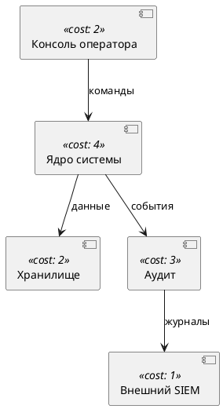

## 13. Версии и этапность

Данное ТЗ описывает версию v0 полностью; отдельные требования с пометкой версии относятся к более поздним выпускам. Соответствие версий:

| Версия | Состав |
| --- | --- |
| v0 (объект приёмки) | Модель, стоимость, покрытие, пул и размещения, декомпозиция, undo/redo, автосохранение, импорт/экспорт architecture.yaml, security.yaml, state.yaml, PlantUML (раздел 6.3); Dockerfile, Makefile, docker-compose (раздел 10); unit- и E2E-тесты (раздел 11); все документы раздела 12 |
| v1 | Прямое перетаскивание карточек между доменами (Ф-9), поиск в пуле, перетаскивание файлов на канву, экспорт сводного отчёта о покрытии и стоимости в YAML, английская локализация, компонентные тесты, E2E в Firefox и WebKit, CI (GitHub Actions: lint, тесты, сборка образа) |
| v2 | Сравнение вариантов решения (снимки проекта и таблица различий), режим преподавателя с оцениванием внутри инструмента, параметризация множителя M, мобильная вёрстка, экспорт отчёта в PDF |

Метки (v1) и (v2) в тексте разделов 4 и 5 указывают на требования, переносимые в соответствующую версию; их реализация в v0 не требуется и не является отклонением.

## 14. Порядок контроля и приёмки

### 14.1. Средства контроля

Приёмка выполняется по трём направлениям: автоматические проверки (`make check` на чистом клоне: lint, типы, unit-тесты с порогами 11.2, E2E-сценарии 11.3); сборка и запуск контейнера (10.2, 10.6); ручной прогон контрольного примера (14.3) с сопоставлением чисел и статусов.

### 14.2. Чек-лист приёмки

| Пункт | Метод проверки | Критерий |
| --- | --- | --- |
| 1 | make check на чистом клоне | Все проверки зелёные, пороги покрытия выполнены |
| 2 | docker-build, docker-run | Образ собирается, контейнер запускается, /healthz возвращает 200 ok |
| 3 | Контрольный пример 14.3 | Все числа и статусы совпадают с таблицей |
| 4 | E2E-сценарий Э-08 и тест T-Y-10 | Round-trip экспорт-импорт эквивалентен (6.6) |
| 5 | Панель ошибок | Каждый код из 6.5 воспроизводится фикстурами invalid/ |
| 6 | НФ-1 | Пересчёт не ощутим (менее 100 мс) при максимальной модели |
| 7 | НФ-2, НФ-4 | Начальный пакет не более 1 МБ gzip; внешних сетевых запросов нет (инспектор сети) |
| 8 | Раздел 12 | Шесть документов + README + CHANGELOG присутствуют, ссылки работают |
| 9 | Раздел 10.3 | Все цели Makefile выполняются; help выводит список |
| 10 | Проверка в двух браузерах | Chrome и Firefox: сценарии Э-01–Э-03 выполняются |

### 14.3. Контрольный пример

Контрольный пример использует демонстрационный комплект (Приложения А и Б; состав функций — 6 карточек с суммарной стоимостью 21, пять целей). Проверяемые состояния:

| Состояние | C_домена по доменам | C_системы | Статусы целей | Статус системы |
| --- | --- | --- | --- | --- |
| После загрузки (ничего не размещено) | core 4, store 2, audit 3, siem 1, ui 2 | 12 | Все 5 красные | Красный |
| Шаг 1: fn-hashing и fn-mfa в blk-core; fn-encrypt и fn-backup в blk-store; fn-auditlog в blk-audit | core 42, store 16, audit 6, siem 1, ui 2 | 67 | Конфиденциальность, доступ, аудит, доступность — зелёные; целостность — красная | Красный |
| Шаг 2: дополнительно fn-integrity в blk-audit | core 42, store 16, audit 18, siem 1, ui 2 | 79 | Все 5 зелёные | Зелёный |

Пояснения к расчёту: blk-core — C_блока 4, S = 3+4 = 7, E = 3, M = 1.5, C_домена = 42; blk-store — C_блока 2, S = 8, E = 1, M = 1, C_домена = 16; blk-audit на шаге 2 — C_блока 3, S = 2+4 = 6, E = 2, M = 1, C_домена = 18. Переход светофора цели «Конфиденциальность»: красная при пустом размещении, жёлтая после размещения только fn-hashing (одна обязательная из двух), зелёная после fn-encrypt — это отдельный проверяемый сценарий Э-06.

Результатом приёмки являются: тег `v1.0.0` в репозитории, собранный образ с тегом из раздела 10.4, отчёт покрытия, заполненный чек-лист 14.2.

## Приложение А. Демонстрационный architecture.yaml

```yaml
version: 1
system:
  name: "АСУ ТП учебного стенда"
  description: "Контрольный пример ТЗ «Конструктор СКИБ»"
blocks:
  - id: blk-ui
    name: "Консоль оператора"
    cost: 2
    position: { x: 60, y: 240 }
  - id: blk-core
    name: "Ядро системы"
    cost: 4
    position: { x: 380, y: 240 }
  - id: blk-store
    name: "Хранилище"
    cost: 2
    position: { x: 700, y: 120 }
  - id: blk-audit
    name: "Аудит"
    cost: 3
    position: { x: 700, y: 360 }
  - id: blk-siem
    name: "Внешний SIEM"
    cost: 1
    position: { x: 1000, y: 360 }
edges:
  - id: e-ui-core
    from: blk-ui
    to: blk-core
    label: "команды"
  - id: e-core-store
    from: blk-core
    to: blk-store
    label: "данные"
  - id: e-core-audit
    from: blk-core
    to: blk-audit
    label: "события"
  - id: e-audit-siem
    from: blk-audit
    to: blk-siem
    label: "журналы"
```

## Приложение Б. Демонстрационный security.yaml

```yaml
version: 1
goals:
  - id: goal-conf
    name: "Конфиденциальность данных"
    description: "Данные доступны только легитимным процессам"
  - id: goal-access
    name: "Управление доступом"
    description: "Доступ к функциям ядра только после подтверждения личности"
  - id: goal-integrity
    name: "Целостность"
    description: "Неавторизованное изменение данных обнаруживается"
  - id: goal-audit
    name: "Аудит и учёт"
    description: "События безопасности регистрируются и передаются в SIEM"
  - id: goal-availability
    name: "Доступность"
    description: "Данные восстанавливаются после инцидента"
functions:
  - id: fn-hashing
    name: "Хеширование паролей"
    cost: 3
    implements:
      - { goal: goal-conf, weight: mandatory }
  - id: fn-mfa
    name: "Многофакторная аутентификация"
    cost: 4
    implements:
      - { goal: goal-access, weight: mandatory }
      - { goal: goal-conf, weight: optional }
  - id: fn-encrypt
    name: "Шифрование хранилища"
    cost: 5
    implements:
      - { goal: goal-conf, weight: mandatory }
  - id: fn-integrity
    name: "Контроль целостности"
    cost: 4
    implements:
      - { goal: goal-integrity, weight: mandatory }
      - { goal: goal-audit, weight: optional }
  - id: fn-auditlog
    name: "Журналирование событий"
    cost: 2
    implements:
      - { goal: goal-audit, weight: mandatory }
  - id: fn-backup
    name: "Резервное копирование"
    cost: 3
    implements:
      - { goal: goal-availability, weight: mandatory }
```

## Приложение В. Демонстрационный architecture.puml

Эквивалент Приложения А в подмножестве PlantUML (раздел 6.3):



## Приложение Г. Реестр принятых решений

| ID | Решение | Обоснование |
| --- | --- | --- |
| D1 | Карточка — визуальное представление функции безопасности; пул строится из security.yaml | Устраняет терминологический конфликт черновика («событие безопасности» не может быть средством защиты) |
| D2 | Формула стоимости 3.3: произведение с множителем связности; домен без функций стоит C_блока; округление вверх | Устраняет неопределённости черновика: нулевые и одинарные стрелки не удешевляют домен, «стоимость системы» формализована |
| D3 | Поле «сложность» исключено из модели; сохранена стоимость реализации | Стоимость инкапсулирует трудоёмкость; меньше атрибутов — меньше ошибок ввода |
| D4 | Связи «функция — цель» с весом mandatory/optional; правила светофора 3.4 | Позволяет отличать обязательный и вспомогательный состав функций; правила формализованы для автотестов |
| D5 | Декомпозиция плоская: домен заменяется 2–6 доменами того же уровня; без иерархии | Соответствует принятой модели; цена изоляции демонстрируется через рост C_системы |
| D6 | Стек: Vite, React, React Flow, js-yaml, zod, zustand; без серверной части | Статическое приложение покрывает все сценарии; данные остаются у пользователя |
| D7 | Двойной формат архитектуры: architecture.yaml и PlantUML; оба импортируются и экспортируются; синхронизации «на лету» нет | Знакомый преподавателям формат диаграмм без затрат на двустороннюю текстовую синхронизацию |
| D8 | Хранение: localStorage и самодостаточный state.yaml | Сдача работы одним файлом; восстановление сеанса после перезагрузки |
| D9 | ГОСТ Р 72118-2025 и ГОСТ ISO/IEC TS 19249-2021 — контекст курса, в интерфейс не включаются | Стандарты не задают проверяемых правил расчёта; интерфейс остаётся предметным |
| D10 | Этапность v0/v1/v2 (раздел 13) | Ядро отделяется от удобств разработки и расширений |
| D11 | Развёртывание: четыре варианта; Docker-образ (multi-stage, без root, порт 8080, /healthz) и Makefile как единая точка команд | Воспроизводимое развёртывание в классе и на приёмке одной командой |
| D12 | Автотесты: Vitest с порогом 90 % для engine и io, Playwright с девятью сценариями | Движок проверяется численно фиксированными кейсами; интерфейс — сквозными прогонами |
| D13 | Документация: шесть документов по ролям плюс README и CHANGELOG | Каждая роль получает собственную инструкцию без чтения всего ТЗ |

## Приложение Д. Структура репозитория

```text
skib-lab/
├── README.md                     # обзор и быстрый старт
├── CHANGELOG.md
├── LICENSE
├── Makefile                      # цели раздела 10.3
├── Dockerfile                    # требования раздела 10.2
├── .dockerignore
├── docker-compose.yml
├── package.json
├── package-lock.json
├── tsconfig.json
├── eslint.config.js
├── .prettierrc
├── .gitignore
├── vite.config.ts
├── playwright.config.ts
├── index.html
├── nginx/
│   └── nginx.conf                # эскиз в Приложении Е
├── public/
│   └── favicon.svg
├── src/
│   ├── main.tsx
│   ├── App.tsx
│   ├── i18n/
│   │   └── ru.ts                 # словарь строк интерфейса
│   ├── engine/
│   │   ├── types.ts              # сущности раздела 3.1
│   │   ├── cost.ts               # алгоритм 7.1
│   │   ├── coverage.ts           # алгоритм 7.2
│   │   ├── decompose.ts          # алгоритм 7.3
│   │   └── limits.ts             # лимиты Ф-17
│   ├── io/
│   │   ├── schema.ts             # zod-схемы
│   │   ├── errors.ts             # коды раздела 6.5
│   │   ├── archYaml.ts           # architecture.yaml
│   │   ├── securityYaml.ts       # security.yaml
│   │   ├── plantuml.ts           # подмножество 6.3
│   │   └── stateFile.ts          # state.yaml
│   ├── store/
│   │   └── projectStore.ts       # zustand + история операций
│   ├── ui/
│   │   ├── TopBar.tsx
│   │   ├── PoolPanel.tsx
│   │   ├── Canvas.tsx
│   │   ├── DomainNode.tsx
│   │   ├── CardItem.tsx
│   │   ├── InspectorPanel.tsx
│   │   ├── GoalsPanel.tsx
│   │   ├── SummaryBar.tsx
│   │   ├── DecomposeDialog.tsx
│   │   └── ValidationPanel.tsx
│   └── samples/
│       └── demo/
│           ├── architecture.yaml
│           ├── security.yaml
│           ├── architecture.puml
│           └── state.yaml
├── tests/
│   ├── unit/
│   │   ├── cost.test.ts
│   │   ├── coverage.test.ts
│   │   ├── decompose.test.ts
│   │   ├── archYaml.test.ts
│   │   ├── securityYaml.test.ts
│   │   ├── plantuml.test.ts
│   │   └── stateFile.test.ts
│   ├── e2e/
│   │   ├── load.spec.ts
│   │   ├── pool.spec.ts
│   │   ├── decompose.spec.ts
│   │   ├── coverage.spec.ts
│   │   ├── persistence.spec.ts
│   │   ├── export.spec.ts
│   │   └── errors.spec.ts
│   └── fixtures/
│       ├── demo/                 # Приложения А, Б, В и state.yaml шага 1
│       └── invalid/              # по одному дефекту на файл
└── docs/
    ├── user-guide.md
    ├── teacher-guide.md
    ├── developer-guide.md
    ├── testing-guide.md
    └── deployment-guide.md
```

## Приложение Е. Эскиз nginx.conf

Эскиз закрепляет требования 10.2; при генерации кода допускаются уточнения, не меняющие наблюдаемое поведение:

```nginx
worker_processes 1;
pid /tmp/nginx.pid;
error_log /dev/stderr warn;

events { worker_connections 1024; }

http {
  include /etc/nginx/mime.types;
  default_type application/octet-stream;
  access_log /dev/stdout;
  client_body_temp_path /tmp/client_temp;
  proxy_temp_path /tmp/proxy_temp;
  fastcgi_temp_path /tmp/fastcgi_temp;
  uwsgi_temp_path /tmp/uwsgi_temp;
  scgi_temp_path /tmp/scgi_temp;

  gzip on;
  gzip_types text/css application/javascript application/json image/svg+xml;

  server {
    listen 8080;
    root /usr/share/nginx/html;
    index index.html;

    # CSP: unsafe-inline для стилей требуется инлайновым стилям React Flow
    add_header Content-Security-Policy "default-src 'self'; style-src 'self' 'unsafe-inline'; img-src 'self' data:" always;
    add_header X-Content-Type-Options "nosniff" always;
    add_header X-Frame-Options "DENY" always;
    add_header Referrer-Policy "no-referrer" always;

    location = /healthz { return 200 "ok\n"; }

    location /assets/ { add_header Cache-Control "public, max-age=31536000, immutable"; }

    location / { try_files $uri $uri/ /index.html; add_header Cache-Control "no-cache"; }
  }
}
```

## Приложение Ж. Эскиз Makefile

Эскиз закрепляет перечень целей 10.3; тела целей могут уточняться при генерации кода:

```makefile
DOCKER ?= docker
IMAGE  ?= skib-lab
TAG    ?= 1.0.0
PORT   ?= 8080
BASE_PATH ?= /

.PHONY: help install dev build preview lint test-unit test-unit-coverage \
        test-e2e test check docker-build docker-run docker-start docker-stop \
        docker-logs docker-shell clean distclean

help: ## список целей (по умолчанию)
	@grep -E '^[a-zA-Z_-]+:.*## ' $(MAKEFILE_LIST) | awk -F':.*## ' '{print $$1" — "$$2}'

install: ## установка зависимостей (npm ci)
dev: ## dev-сервер Vite, порт 5173
build: ## производственная сборка в dist/
preview: ## локальный запуск собранной версии, порт 4173
lint: ## eslint + tsc --noEmit + prettier --check
test-unit: ## unit-тесты Vitest
test-unit-coverage: ## unit-тесты с покрытием и порогами
test-e2e: ## E2E-тесты Playwright (поднимает preview сам)
test: ## test-unit затем test-e2e
check: ## lint затем test — полная локальная проверка
docker-build: ## сборка образа $(IMAGE):$(TAG)
docker-run: ## запуск образа на переднем плане, порт $(PORT)
docker-start: ## запуск в фоне с именем skib-lab
docker-stop: ## остановка и удаление skib-lab
docker-logs: ## логи контейнера skib-lab
docker-shell: ## оболочка sh внутри контейнера
clean: ## удаление dist, coverage, playwright-report, test-results
distclean: ## clean плюс удаление node_modules
```
